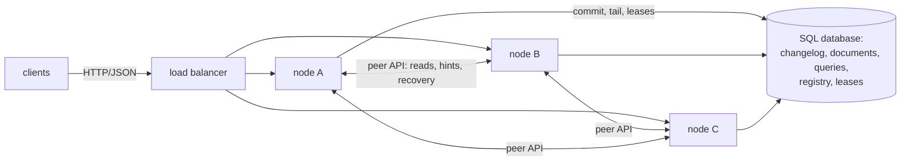
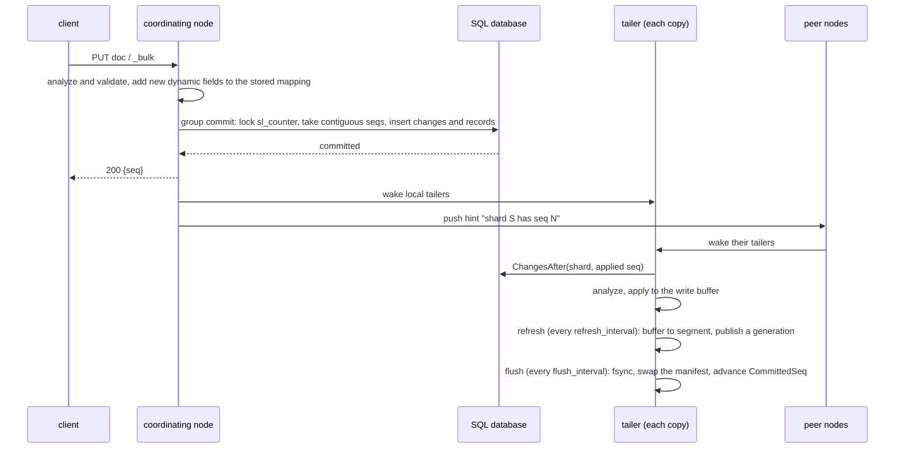
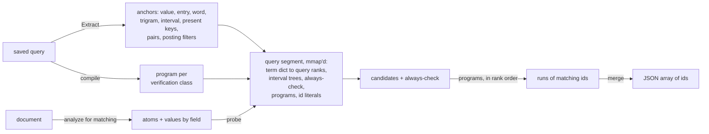

# Searchlight architecture

This is how Searchlight is built, as the code stands. The design and its reasons are in
[the spec](superpowers/specs/2026-10-02-searchlight-design.md), and the order the work is
built in is in [the plan](superpowers/plans/2026-10-02-searchlight.md).
[Known gaps](#known-gaps) lists what the spec promises that is not in the code yet.

## In one paragraph

Every node of a cluster is the same binary. Each node keeps Lucene-style segments for its
shard copies on local disk and serves the whole HTTP API. Durable state lives in one SQL
database (Postgres, MySQL or SQLite), and nowhere else:

- **The changelog** (`sl_changes`) is the write-ahead log. A write is acknowledged once
  its transaction commits.
- **The documents and saved queries** (`sl_documents`, `sl_queries`) are the system of
  record, each row with the seq of its last write and the client version it named.
  `sl_tombstones` keeps the version of each id a versioned delete removed. A versioned
  change is checked inside its transaction, under the counter lock, against the row's
  version or, while the row is absent, the tombstone's: at or below it, the change is
  dropped as a noop and takes no seq. A saved query's version also rides its changelog
  payload, so copies index it with the query (`percolate/4` keeps it per query).
- **The registry** (`sl_nodes`, `sl_shard_copies`) is how nodes find each other, and its
  leases decide who holds which shard copy.

Every shard copy tails its shard's changelog in sequence order, so local segments are
only a cache: they can always be rebuilt from a peer or from the database.



## Components

| Package | Role |
|---|---|
| `cmd/searchlight` | Wiring: config, telemetry and the admin listener, store, cluster node, public listener, signals and the shutdown order |
| `internal/config` | Every setting from flags, `SEARCHLIGHT_*` variables and `*_FILE` secrets, validated at start |
| `internal/api` | The public HTTP API: routing, auth, limits and backpressure, problem JSON, `refresh` and `wait_for_seq`, readiness, graceful drain |
| `internal/cluster` | `cluster.Node`, the only coordinator, a cluster of one included. It covers membership, leases and fencing, the allocator, peer recovery, routing with adaptive replica selection and retries, push hints, maintenance (pruning), cluster health and the rolling shutdown |
| `internal/node` | The engine under the cluster node: the index catalogue, the write path (analysis, mapping updates, group commit), one hosted copy and tailer per shard, reads with read-your-writes, scatter-gather and reduce |
| `internal/replica` | The tailer: keeps one shard copy in step with the changelog (recovering, tailing, halted) |
| `internal/shard` | One shard copy: write buffer, refresh into segments, generations published atomically, flush to a durable manifest, deletes sidecars, tiered merges under a node-wide budget, filter cache |
| `internal/segment` | The immutable on-disk segment format: term dictionaries, roaring postings, doc values, BKD-lite points, k-d trees of point fields, zstd stored fields, ids. Read through mmap and checksummed |
| `internal/search` | Planning (cost-ordered bitmap operations plus residual checks), per-segment execution, sort, `from` and `search_after` paging, aggregations, cross-shard reduce |
| `internal/reqcache` | The shared stores behind search's shard request cache: Redis, behind a breaker |
| `internal/percolate` | The reverse index of saved queries: anchor extraction, query segments, candidate generation, verification by compiled programs that mirror the exact matcher |
| `internal/query`, `internal/schema`, `internal/analysis` | The query language and exact matcher, mappings and document analysis, and the normalizers (byte-for-byte compatible with scrape-bot) |
| `internal/store` | The SQL store: changelog, records, catalogue, registry and leases, blobs. Its logic is written once, and each dialect (`postgres`, `mysql`, `sqlite`) owns its SQL and embedded migrations |
| `internal/telemetry` | slog JSON logs with trace ids, OpenTelemetry traces and metrics, Prometheus, pprof |
| `internal/heapfloor` | Keeps the garbage collector from running while the heap is under `gc_heap_floor`: segments are mapped, so the live heap is small |
| `internal/clock` | The engine's source of time: every timer, ticker, sleep and elapsed-time reading goes through an injected `clock.Clock`, `clock.Real` in production and `clock.Fake` in tests |

Packages depend one way: `cmd → api, cluster → node → replica → shard → segment`, with
`search`, `percolate`, `query`, `schema` and `analysis` below them, and `store` beside
them.

## The write path: the SQL changelog is the WAL



1. **Validation.** The coordinating node, which is any node, analyzes and validates the
   write. If the write brings new dynamic fields, it adds them to the stored mapping
   first: the database's mapping is the one arbiter of a field's type, so every copy
   analyzes the document alike.
2. **Commit.** The changes go through the node's group committer. Concurrent requests on
   a node are coalesced into one transaction every few milliseconds, as Elasticsearch
   amortizes translog fsyncs.
   - `Apply` locks the counter row and takes contiguous seqs, then inserts the change
     rows and the document or query rows, and commits.
   - Commit order therefore equals seq order, and a tailer never skips a change that
     commits late.
   - The write is acknowledged with its seq only after the commit.
3. **Wake-up.** The node never writes a shard itself. It wakes its own tailers, and the
   cluster pushes a hint to the peers holding copies of the written shards.
   - On Postgres, `LISTEN/NOTIFY` also wakes every tailer.
   - Polling every `changelog_poll_interval` is the safety net everywhere.
4. **Apply.** Each copy's tailer reads `ChangesAfter(shard, appliedSeq)`, analyzes the
   changes and applies them to the shard's write buffer. Seqs are global, so a shard
   sees gaps. A short page proves that nothing below the head is missing, and the copy
   advances past the gap.
5. **Refresh is visibility.** Refreshes tick on a fixed grid, every `refresh_interval`
   from the copy's open, so a refresh's own cost never stretches the period. One that
   overruns skips the ticks it missed. `refresh=true` forces one at once, and a full
   buffer (64 MiB) starts one early.
   - The buffer becomes an immutable segment, written without fsync. The deletes it
     masks stay in memory.
   - The new generation (the list of segments) is published through an
     `atomic.Pointer`, and readers never lock.
   - `refresh=wait_for` waits for the first published generation that covers the write;
     it never forces a refresh, and never waits for durability.
6. **Flush is durability.** A flush runs every `flush_interval` (10 s), at shutdown, at
   every merge commit and before a peer snapshot.
   - It fsyncs the segment files no flush has synced, and writes and fsyncs the deletes
     sidecars.
   - It swaps the manifest, the copy's commit point, atomically: temp file, fsync,
     rename, directory fsync.
   - Only then does it advance `CommittedSeq` to the manifest's seq. The copy reports
     that as its applied seq, and the changelog is never pruned past it. So
     `CommittedSeq` only ever claims what is on disk.
   - A failed fsync is never retried: after a write-back error a later fsync can
     succeed over lost pages. It fails the copy, which reopens from its last flushed
     manifest.

There is no per-node translog: the SQL changelog is the write-ahead log, so nothing a
copy publishes needs to be durable on the copy first. After a crash, a copy reopens the
segments of its last flushed manifest and replays the changelog from that manifest's
seq, which is at most `flush_interval` of changes.

### Shards and segments

```
data_dir/
  indexes/<index uid>/<shard>/      one shard copy's root
    manifest                        SLMANIFEST header + JSON: gen, seq, segments, query_segments
    <segment id>.seg                immutable, mmap'd, CRC32C per section and whole file
    <segment id>.<gen>.del          deletes sidecar of a generation (the segment is never rewritten)
    CURRENT, copy-<n>/              an aside rebuild: the new copy is built in a subdirectory
                                    and made current by rewriting CURRENT atomically
  recovery/<index>.<shard>/         peer recovery staging
```

- **Updates and deletes** mark older segments' documents dead in a per-generation
  sidecar. An id the buffer touched masks every older version of it at the same refresh
  that publishes the new one, so no reader ever sees two live versions of an id.
- **Merges** follow a tiered policy, like Lucene's. A merge writes a new segment,
  publishes it, then flushes, so its manifest never lists an unsynced file. Merges run in
  the background and share a node-wide budget: `merge_threads` for CPU and
  `merge_budget` bytes per second for I/O. Deleted documents are dropped as segments
  merge.
- **Files are removed** only once no durable manifest lists them. A sidecar goes at the
  first flush whose manifest drops it. A merged-away segment goes once that flush has
  run and the last reader has released it. Open removes whatever a crash left that the
  manifest does not list.
- **Caches.**
  - The filter cache keeps per-segment bitmaps of frequent leaves, and needs no
    invalidation because segments are immutable.
  - The rank cache keeps each segment's id ranks for sorts that tie: up to 256 MiB, at
    most 64 MiB for one segment.
  - The global-ordinals cache keeps, per field and segment list, the map from each
    segment's term ordinals to the shard's sorted union of them: up to 256 MiB, built
    by a terms or cardinality aggregation over many of the field's terms, at a cost
    that grows with its distinct terms. A refresh or merge makes a new segment list,
    whose ordinals are derived from the old list's when that is cheaper than a full
    merge of the dictionaries: the segments kept keep their maps (renumbered), a
    removed segment's map and the terms it alone held go, and an added segment's
    terms are looked up in the old dictionary in one ascending galloping pass and
    inserted where missing, which gives exactly the full build's ordinals. A small
    refresh segment is derived; a merge into a segment holding much of the field is
    built in full. After each refresh or merge the fields searches used over the
    shard in the last 10 minutes are rebuilt in the background. Every build takes a
    slot of one pool (a quarter of the CPUs); a shard's field has at most one in
    flight, which a newer generation's supersedes, and a closing shard cancels its
    builds, waits for them and drops its entries. A search's build is served before
    queued warm ones. A build runs detached from the search that asked, once for
    every search asking: a search never waits on a queued build and on a running one
    at most 250 ms, then merges by term, exactly, and the build finishes and is
    cached for the next. The old
    list's entry is dropped once the new one's is cached.
  - The OS page cache holds the mmap'd files.
- **Point fields** ([`xy.go`](../internal/segment/xy.go)). A segment holding a point
  field writes an XY section (format 4.1; one without is 4.0, byte for byte as
  before, and a 4.0 reader ignores the section): per field a static k-d tree of its
  (x, y, document) triples, as Lucene's BKD tree indexes `XYPoint`.
  - Coordinates are kept as sortable 64-bit keys (a float's bits turned so unsigned
    order is numeric order, -0 read as 0), so a box is integer comparisons.
  - The triples are split into leaves of 512. Each node of the tree covers a run of
    leaves and splits it in half along the axis whose spread, relative to the field's
    whole spread on that axis, is the wider (a quickselect, not a sort), so the tree
    splits dates and scores alike whatever their units. Every node records the box
    its points span.
  - A leaf stores its points' x and y as frame-of-reference bit-packed deltas from
    its own minimum, and their documents bit-packed, sorted by the axis it spreads
    wider on: about 14 bytes per point for a date and a two-decimal score in 1M
    documents.
  - A box query descends only into the nodes its box meets. A node it covers whole
    contributes its leaves' documents without a coordinate read; a leaf it meets in
    part is two binary searches on its sorted axis, then a check of the other axis
    only when the box cuts that one too. Documents are gathered in a list, then, past
    1/1024 of the segment, in a dense bitset. A document matches once one of its
    points is inside, so a document with points (1, 10) and (10, 1) never matches
    x >= 5, y >= 5.
  - The planner estimates a box from the node boxes alone (no leaf read), spreading
    the points it counts over the field's documents, and caches a box's bitmap in
    the filter cache as it does a range's.
  - Build and Merge put a field's points in one canonical order (document, x, y)
    before the tree is built, so a merge writes the same bytes as a rebuild of its
    live documents; a merge reads its inputs' trees, drops deleted documents' points
    and renumbers the rest. Building holds 24 bytes per point in memory, and
    partitions with a quickselect per node rather than sorting.
  - Why a tree, not the points sorted by x with each one's y beside it: the workload's
    boxes are one-sided on both axes (x >= T, y >= c). Sorted by x, such a box reads
    every point from T on, however few pass the y bound; the tree prunes on both
    axes. One segment of 1M documents holding 10M points (x a date over a year, y a
    score in [0, 100); [`xy_bench_test.go`](../internal/segment/xy_bench_test.go),
    Ryzen 7 3700X):

    | Box | Documents | Tree | Sorted by x |
    | --- | --- | --- | --- |
    | x >= the year's last 50%, y >= 50 | 842,888 | 11.2 ms | 24.8 ms |
    | x >= last 10%, y >= 90 | 94,270 | 0.44 ms | 1.59 ms |
    | x >= last 1%, y >= 90 | 10,059 | 0.17 ms | 0.26 ms |
    | x >= last 90%, y >= 99 | 85,504 | 0.62 ms | 10.5 ms |
    | x >= last 90%, y <= 1 | 85,919 | 0.58 ms | 12.1 ms |
    | x >= last 0.1%, any y | 10,014 | 0.33 ms | 0.10 ms |

    The one box the sorted scan wins is a bound on x alone, which reads only its
    matches there, where the tree also scans the leaves along the bound. An estimate
    from the node boxes takes 0.5 µs.
- **Nested fields** ([`nested.go`](../internal/segment/nested.go)). A segment whose
  documents hold a nested field's members writes a NESTED section (format 4.2; one
  without is written in the minor before, byte for byte as before): per field an
  *object segment* and the documents' *starts*.
  - The object segment is a whole segment image (header to footer, with its own
    checksums) over object ordinals, flagged as one and holding no STORED and no IDS
    section. Its fields are the nested field's own name, present for each member that
    is an object, and the sub-fields by their full names (`_v.size`): built by the
    builders documents are built by (every term dictionary, column and point index of
    a sub-field is the one a document field of its type would have) and read by the
    same `Reader`.
  - The starts are each document's first object ordinal, then the object count,
    bit-packed: document d's objects are `[starts[d], starts[d+1])`, in array order. A
    member that is no object holds its ordinal and nothing else.
  - The documents are untouched: their ordinals, ids, stored bodies, deletes and
    every structure of their own fields (the nested field itself is only present) are
    what they would be without the section. An object is live while its document is.
    Build numbers objects in document order, across parallel build ranges, and a merge
    keeps the live documents' objects in that order, merging the object segments as
    it merges segments, so a merge writes the same bytes as a rebuild.
  - A nested query runs its inner query over the object segment through an execution
    of its own (`segExec.inner`): the same candidates, residual checks, cost order and
    two-phase approximation, its "every document" the members that are objects, so a
    `not` inside negates per object. Its approximation comes back to documents through
    the starts (`Nested.Parents`, galloping from the last document found): a document
    surely matches when one of its objects surely does, may when one may, and a maybe
    document is decided by its maybe objects' residual checks; a phrase's residual
    reads the object's member of its document's stored body. With few documents in
    question the inner query runs over their objects alone. The filter cache, the
    request cache, totals and sorts stay the documents'.
  - An aggregation on a sub-field collects the objects of the hits (those its `where`
    matches); `terms` counts a document once per value with each value's last
    counted document, and its partial is keyed by value, never by ordinal. Each of its
    buckets holds its sub-aggregations' collectors, made at the bucket's first object:
    one on a top-level field built on the parent segment and fed each document once
    (when the bucket first counts it), one on a sub-field built on the object segment
    and fed each object (those its own `where` matches, a bitmap computed once per
    segment). A `terms` there is keyed by value too and never cut by a shard, so the
    shards' lists merge by key exactly. A sort on
    a sub-field reads, per document, the least or greatest value among its chosen
    objects, from a bitset of them. Inner hits are read at the coordinator from each
    fetched body, by the inner query's compiled matcher on each member.
  - The percolator compiles a nested node to a program (`pNested`) holding its
    sub-fields' slots: each object of the document fills them in turn while the inner
    program runs. A saved nested query anchors on its inner query's atoms (see Anchors).
  - On BenchmarkNested*/Flat* (20,000 products of five variants, one merged segment,
    Ryzen 7 3700X), the correlated query "size L, in stock, under 150" takes 0.67 ms
    nested against 0.21 ms over one document per variant; a `terms` with a `where`
    1.4 ms against 0.24 ms (which counts from the dictionary); a sort by the cheapest
    in-stock variant 1.3 ms against 0.1 ms (which walks the point index).
- **Document seqs.** A copy keeps each document's seq, the seq of the change that wrote
  the version it indexes, in a numeric column of its own (`schema.SeqColumn`, a name no
  mapping or document member can take), added as the change is applied: no query reads
  it, and a hit's `_seq` (`seq_no`) and a stored document's percolation `_seq` are read
  from it. Segments written before it have no such column, and their documents no seq.
- **Format versions.** The segment format is versioned (major 4, minor 1 for a segment
  holding a point field, 2 for one holding a nested field's objects; a binary reads its
  own major and the one before). A copy whose files
  are damaged (a bad checksum, a damaged manifest, a listed file missing:
  `segment.ErrCorrupt`) or of an older format is wiped and rebuilt like a new one, never
  served. A copy of a newer format (`segment.ErrNewerFormat`) is refused and left as it
  is, and any other open failure (I/O, permissions) is retried, never wiped.

### Search

1. **Plan.** The planner normalizes the query and orders its leaves by cost, from
   per-segment term statistics.
   - Leaves that a bitmap can answer become roaring operations: `all` intersects
     smallest first, `any` unions, and `not` complements against the live documents.
   - The rest become residual checks over doc values: `contains` behind a trigram
     prefilter, `similar` behind trigram candidates, and ranges served by points.
   - A search with `size` 0 first asks the shard request cache
     ([`request_cache.go`](../internal/search/request_cache.go)): an LRU in memory
     keyed by the copy's generation, then, when one is configured, a Redis shared by
     every copy and node, keyed by the shard's newest change the copy holds (as its
     changelog poll checked it). A complete result is stored in both, a timed-out one
     in neither.
2. **Execute.** Segments are searched in parallel on the `search_threads` pool. Each one
   produces hits, a top-k for the sort, and partial aggregations.
   - A box leaf is collected from its field's k-d tree, exactly: no residual check.
   - A range leaf is collected from the point index, or checked on doc values when far
     fewer documents are left in question than it matches.
   - A number sort over many hits walks the point index's blocks from the cursor and
     stops once its top-k is settled.
   - Range and histogram aggregations over most of a segment count from the point index;
     terms and cardinality on keyword and list fields count by ordinal, merged across
     segments by global ordinal when the hits hold many of the field's terms, by term
     otherwise.
   - A large segment's per-document aggregation is collected in parallel parts.
3. **Reduce.** Results reduce across segments, then across shards on the coordinator.
   With several shards, the query phase runs without bodies, and only the winning hits'
   bodies are fetched. The copy pins its generation between the two phases (a peer for
   `PinTTL`, 30 s), and a pin outlives its copy's serving: a copy that retires or
   closes between the phases still answers the fetch. A shard whose fetch finds its
   pin gone anyway (expired, or its node stopped) has its query phase run again,
   preferring another copy, up to three times within the request's deadline and what
   is left of its `timeout`, and the shards' results are reduced again; only the
   shards run again are fetched again.

### Percolator



- **Anchors.** Each saved query is reduced to anchors: atoms at least one of which every
  matching document must hold. Queries that cannot be anchored (`not`, `ne`,
  `exists:false`, `empty`, the match-all root) go on the always-check list. A query
  anchored on terms alone also carries a posting filter, a cheap conjunct of its root
  (a number range, a bool, a text the field must not equal, or an entry it must not
  hold) that a document must pass to become a candidate. A `words_*` phrase anchors on
  the pair of its two rarest words.
- **Nested anchors.** A nested node anchors as its inner query would, on its path's
  sub-fields by their full names (`_v.size`), and a document holds the atoms of every
  one of its objects' values of them: the object a match needs holds the anchor, so
  the document does. Only an inner query with no positive conjunct (a `not`, the
  match-any `{"all": []}`) leaves the node Always. A sub-field's cost counts the
  objects holding the term (`Generation.DocFreq`, an upper bound on the documents), or,
  without statistics, scales its prior by 8: a document holds an atom when any of its
  objects does, so a top-level anchor of the same group wins unless the variant's is
  rarer. On BenchmarkPercolateNested (100k saved searches, 70% of them variant
  searches), always-check queries fall from 9,867 to 0, and throughput rises from
  1,564 to 6,692 documents a second.
- **Query segments.** Anchors live in percolator segments (`percolate/4`) that refresh
  and merge like document segments, under their own merge policy (two per tier). Every
  query segment costs every document a probe, so the policy keeps them few. A segment is
  memory-mapped and validated at open; nothing per query goes on the heap. It holds the
  term dictionary, interval trees, always-check list, one compiled program per
  verification class (queries with the same canonical form), each query's client
  version, and every id as its JSON
  literal. All of these are numbered by rank (id order), so candidates read in order
  are matches in output order.
- **Percolating a document.** The document is analyzed for matching (no grams). Its
  values are laid out by field index, and its atoms probe each query segment for
  candidates, with filtered postings checked as they are read. The always-check list
  is added.
  - **Verification.** Each candidate's class runs its program over the document's
    values, once per class per document. A program mirrors the exact matcher and leaves
    out the root conditions the candidate's anchors and filter already prove.
  - **Output.** Each segment's matches are a run of ranks, so sorted by id. The runs
    merge into the JSON array the response copies as it is; the least run's ids below
    the next least run's are found by galloping and copied in one go.
  - **One document on several cores.** When a request percolates fewer documents than
    the node has cores, a large enough document splits by id into windows: quantiles of
    ids sampled from every segment, two windows per worker. Workers take the windows in
    turn, each collecting, verifying and merging only the ranks in its window. Windows
    hold disjoint id ranges in order, so their answers concatenate. A document splits
    only while the workers of every document being split on the node fit in
    `search_threads` (one count the node's percolators share). Each shard copy's
    percolator keeps the plan of the last set of query segments and worker count it
    split for, so requests alternating between documents whose worker counts differ
    (one document, then two) rebuild it each time: a few hundred id reads and a sort.
  - **Details.** Asked for matches' details, the copy that percolated reads them after
    the matches: each matched id's query segment and ordinal (`LookupQuery`), its
    version from the segment's version section, and, for inner hits, its query once
    per request (parsed and compiled, `search.QueryInnerHits`), whose nested nodes'
    inner hits it reads off the analyzed document's objects as a search reads them off a
    hit's body. The coordinator merges each document's matches from every shard by id
    (disjoint: a query lives on one shard).
  - **Shards at once.** The coordinator percolates every shard's copy at once (local
    copies on their percolators, peers over the peer API; local ones in turn, in the
    caller's goroutine, below 64 documents, as their percolators use every core
    already) and merges their answers; the first shard to fail cancels the rest.
  - **Exactness.** The answer is exactly the brute-force one. Property tests check that
    the candidates always include every true match, and that every program decides as
    the matcher does.

## The cluster

### Membership, leases and fencing

- **Membership.** A node registers in `sl_nodes` and heartbeats every 2 s. A node silent
  for 10 s is dead. Peers are discovered from the same table, so a node needs only
  `store_url`, plus `advertise_address` when its listen address is not what peers dial.
- **Slots and epochs.** Each shard copy is a slot in `sl_shard_copies`, held under a
  lease (`lease_ttl`: 10 s, or 30 s on SQLite) with a **fencing epoch** taken from a
  database counter at each claim. Every registry write a copy makes is conditional on
  its slot, node and epoch, so a node that lost its lease gets `ErrLeaseLost` and can
  never overwrite its successor.
- **Local deadline.** The node renews its leases on the heartbeat tick. It keeps a local
  deadline per copy on its own monotonic clock, measured from just before each renewal.
  Past the deadline, less a margin, the copy stops serving and its tailer stops, before
  any other node can claim the slot.
- **Allocation.** Every node runs the allocator. A shard below its copy target
  (`replicas_per_shard`; by default every node holds every shard) is claimed by an
  eligible node with a conditional insert or update: one without a copy of that shard,
  with spare capacity, least loaded first. When a target is lowered, the extra slots are
  released.
- **Copy states.** A copy is `recovering`, `serving` or `retiring` in the registry.
  Locally it can also be `halted` (see [operations](operations.md#troubleshooting)).

```mermaid
stateDiagram-v2
  [*] --> recovering: claim (new epoch)
  recovering --> serving: snapshot fetched, changelog replayed
  serving --> recovering: halted at a change, corrupt segment, pruned past
  serving --> retiring: drain / stop
  retiring --> recovering: same node restarts, reclaims at the same epoch
  serving --> [*]: lease expires (node died); others claim
```



### Peer recovery

A copy that must be built, whether new, wiped, pruned past or corrupt:

1. **Snapshot.** The tailer asks a serving peer for a snapshot. It picks the best peer
   first, by adaptive replica selection. The peer flushes first, then pins the
   generation that flush made durable, so it never hands out a seq it could itself lose.
   It lists that generation's files with their sizes and SHA-256 sums: segments,
   deletes sidecars and a manifest.
2. **Staging.** Each file is streamed into `data_dir/recovery/…` as `name.part` and
   checked against its sum, then renamed and fsynced.
   - An interrupted transfer resumes with an HTTP Range request.
   - A file already staged with the right sum, even by an attempt against another peer,
     is not fetched again.
   - A stream idle for 30 s is cut, and resumed.
3. **Commit.** The files move into the copy's empty directory, and the manifest is
   written last, as the commit point. A recovery cut short anywhere before the manifest
   leaves a directory that opens empty.
4. **Catch-up.** The tailer opens the copy and replays the changelog from the snapshot's
   seq, and the copy turns `serving`.

When no peer can serve, the newest **recovery bundle** of the shard is restored
instead, if `bundle_interval` uploads them:

- **Upload.** Every `bundle_interval`, the serving copy of each shard on the live node
  with the lowest id flushes and streams its durable generation into one blob in
  `sl_blobs` (`bundles/<index>/<incarnation>/<shard>/<seq>`): a header listing every
  file's name, size and SHA-256, the manifest last, then the files. The blob store
  chunks it and sums it. An upload whose commit's outcome is unknown counts only when
  `Stat` shows the stored sum is the one streamed. The oldest bundles past
  `bundle_retention` are then deleted.
- **Restore.** The newest bundle the changelog still reaches is staged under
  `data_dir/recovery/…/bundle`, every file checked against its sum and fsynced, and the
  blob's own sum checked at its end. Only then are the files moved into the copy's
  directory and the manifest written last. A bundle failing any check is never
  installed; the next older one is tried.

When neither a peer nor a bundle serves, or any step fails, the copy is rebuilt from the
database instead: `ScanShard` streams the shard's current rows as of a seq, and the
changelog is replayed from there. A copy that is outdated but still valid is rebuilt
aside, so it keeps serving until its replacement catches up.

### Routing

Any node takes any request.

- **Writes** go to SQL first, the commit point (see the write path above).
- **Reads** use this node's copy when it is serving and current. Otherwise they go to a
  serving copy elsewhere whose lag is within `max_lag`, chosen by adaptive replica
  selection on measured latency, like Elasticsearch's ARS. A failed or timed-out attempt
  (10 s) is retried on another copy, so with two or more copies, one node failing is not
  a client error. The copies a read knows of come from this node's view of the registry,
  which can trail it by a refresh. When every one of them has failed (or refused the read
  for an older wire level), the read reads the copy table again, once per shard, and
  tries the serving copies it has not tried, a node at a new address included. A view
  read since the shard was routed (by another shard of the request, or the view loop)
  serves without a read, and concurrent re-reads share one. A read waits on its re-read
  for at most a quarter of the request's remaining time, and 1 s, so it still has time
  for the copies it finds and for this node's own copy, which a read falls back to
  (stale) when no copy elsewhere answers. The registry read goes on (up to 2 s) after a
  read stops waiting, and its view serves the reads after it. Registry reads for
  routing are 75 ms apart, so a re-read that needs one realistically needs 400 ms or
  more left on the request; one with less mostly gives up, and a later read benefits.
  When nothing
  new turns up, the copies that refused only for being stale are asked once more,
  accepting a stale answer, and then the shard is a 503.
  `searchlight_cluster_read_rereads_total` counts each shard's re-read (whether it read
  the database or took a newer view), by `op` and `result`: `found`, `none`, or
  `timeout` (it gave up first). Routing's own read for a shard with no copy in view is
  not counted, and stands for the shard's one re-read.
- **Peer traffic** (reads, hints, snapshots) uses the internal API under `/_internal/` on
  the same listener. It is authenticated by `cluster_token`, and runs over TLS when
  `tls_cert` is set, with peers verified against `peer_ca_file`.

### Rolling restarts

On SIGTERM, a node:

1. turns readiness false;
2. retires each copy that a serving copy elsewhere can stand in for. It stops the copy's
   tailer and marks it `retiring`, and the database checks atomically that another copy
   still serves, so nodes draining together never retire a shard's last serving copy;
3. keeps serving for `shutdown_grace`, then drains its listener;
4. stops its remaining copies' tailers together, each writing its final manifest and
   applied seq, then marks those copies `retiring` (no tailer is left to change their
   state) and closes them;
5. deregisters.

The leases are not released: the rows stay `retiring` at their final applied seqs.
Pruning keeps the changelog the node needs for `retiring_retention` (15 min). When the
node comes back, it reclaims its own slots at the same epochs, reopens its segments and
replays only the tail. Restart time does not grow with index size.

### Changelog pruning and maintenance

The live node with the lowest id is the leader. No election is needed, because its jobs
are idempotent. The leader:

- prunes each shard's changelog below the lowest applied seq of the copies that count.
  A copy's applied seq is its `CommittedSeq`, what its last flush made durable;
- sweeps abandoned blob uploads.

The copies and recovery points that count are:

- the live copies, a recovering copy holding its slot at seq 0 included;
- a cleanly stopped node's retiring copies, for `retiring_retention` after their leases
  ran out;
- every retained recovery bundle of the shard's current incarnation, at its seq.

The floor is bounded, so no copy can hold it forever:

- a copy behind the others that makes no progress for `prune_stall_timeout` stops
  counting;
- a change older than `changelog_retention` is pruned whatever still needs it, and a
  bundle it prunes past is deleted.

A copy pruned past rebuilds from a peer or the database. The leader also deletes the
bundles of dropped indexes. Every node also collects its own
unused copy directories and stale recovery staging.

## The binary's lifecycle

```mermaid
sequenceDiagram
  participant M as main
  participant Adm as admin listener :8781
  participant St as store
  participant N as cluster.Node
  participant Api as public listener :8780
  M->>Adm: telemetry, then serve /healthz, /readyz (503 until the API exists), /metrics, pprof
  M->>St: open, migrate (under a lock), retried with backoff while unreachable
  M->>N: cluster.New (engine opens the catalogue)
  M->>Api: serve Node.Handler(API) before Start: peers may call at once
  M->>N: Start: register, read registry, SQLite single-node check, allocate, loops
  Note over M: SIGINT / SIGTERM fixes deadline D = now + shutdown_grace + T
  M->>Api: readiness false; Drain retires covered copies (T/4); serve for shutdown_grace
  M->>Api: stop accepting, finish in-flight requests (T/4)
  M->>N: Stop: tailers stopped (final manifests), rows retiring, copies closed, deregister (until D - T/10)
  M->>St: close
  M->>Adm: close
  M->>M: telemetry flush, exit 0
```

The whole shutdown fits one budget, fixed at the signal: `shutdown_grace` plus
`shutdown_timeout` (T). The drain and the listener get T/4 each, the node's stop runs
until T/10 before the deadline (at least 0.4 T), and the store, the admin listener and
telemetry close in the last T/10. A second signal ends the process at once. A signal
during startup stops the node cleanly too, with exit code 0.

## Time: the injectable clock

Every timer, ticker, sleep and elapsed-time reading in the engine goes through an
injected `clock.Clock` (`internal/clock`). That covers shard refreshes and flushes,
replica polling and backoff, cluster heartbeats, leases and maintenance, the group-commit
window, the API's request timing and its shutdown grace.

- **Production.** `clock.Real` runs everything. `cmd/searchlight` passes it to the store,
  the cluster node (which hands it to the engine) and the API.
- **Tests.** They drive a `clock.Fake`, advancing it instead of waiting.
- **Monotonic and wall time.** Durations use the monotonic reading, so a stepped wall
  clock never stretches a measured interval. Lease validity also checks the wall clock,
  which keeps running while a machine is suspended.
- **Enforcement.** A forbidigo rule in `.golangci.yml` forbids direct `time.Now`,
  `time.After`, timers and sleeps in the engine's production packages: `shard`,
  `replica`, `cluster`, `store`, `node` and `api`.
- **Refresh scheduling.** Refreshes run on a fixed grid of this clock (`clock.GridLoop`).

## Benchmarks

The harness in `bench/` runs the real binary against Elasticsearch 8, restarts and
recoveries included; the chaos suite in `test/chaos` covers the failure targets.
`docs/benchmarks.md` holds the latest 1M-document run on `main`, graded against every
spec §1 target.

## Known gaps

- **Background scrub** ([#36](https://github.com/Imposter/go-searchlight/issues/36)):
  a segment is checksum-verified when its copy opens, so bit rot after open is served
  until the copy is next opened.
- **A percolator format change rebuilds the whole copy**
  ([#37](https://github.com/Imposter/go-searchlight/issues/37)): document segments one
  major version old are read as they are (`segment.ReadsMajor`: format 4 reads format
  3), but a change to the saved-query segments' format (`percolate/N`) wipes the shard
  copy, documents included, and rebuilds it, rather than rebuilding only its query
  segments.
- **Scale beyond RAM and many nodes** (spec T11): designed for (memory-mapped segments,
  shards across nodes) but not benchmarked yet.
