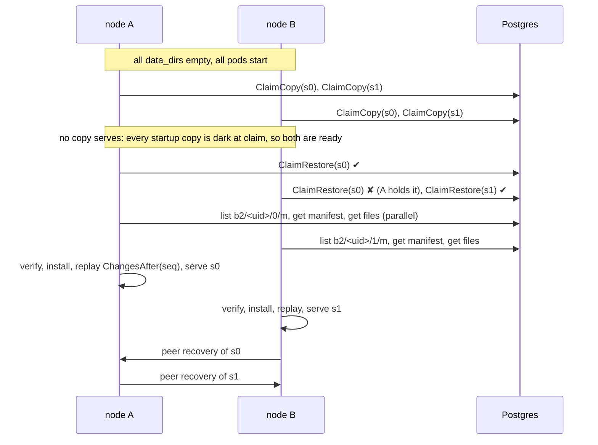

# Stateless nodes design

**Status:** design, 2026-10-10. The operator's answers of 2026-10-10 are folded in as decisions (§13). No product code is written yet.
**Base:** `main` at 198b96d. It amends the [main spec](2026-10-02-searchlight-design.md): §1 (T8, T9), §8 (`sl_blobs`), §9 (recovery, rolling restarts, pruning), §10, §12 and §17.
**Inputs:**
- The stateless spike, `.superpowers/reports/spike-stateless.md` (cited as **[spike]**, with its gaps G0–G12). Its code citations are at e2f3490. The citations below were re-checked at 198b96d.
- The CI benchmark at 971585f, `.superpowers/reports/bench-main-37577211638.md` (**[bench]**).
- `docs/operations.md` (**[ops]**).

**How numbers are marked.** Every number is one of these:
- **M**: measured, with its source;
- **E**: an estimate derived from measurements, not measured itself;
- **T**: a target that this design must meet and the benchmark must prove.

The spike ran on one Windows box with a 7200 rpm HDD. Its absolute times are pessimistic, and only its ratios carry over.

---

## 0. Summary

The operator decided on 2026-10-10 that nodes are completely stateless:
- no persistent volumes;
- `data_dir` is an `emptyDir`;
- a node restores its storage from the database, and peers are only an optional speedup.

This design makes that cheap and safe:

1. **Restart means restore.** T9 changes meaning. A pod replaced with an empty disk restores its copies, and its target becomes a restore-time bound. The old reopen path stays as an optimisation: an `emptyDir` survives container restarts inside a pod, so a crashed or OOM-killed container still reopens in seconds.
2. **Recovery order: peer, then bundle reload, then `ScanShard`.**
   - A serving peer is tried first, as today.
   - Next comes the database path: download, verify, open and replay a recovery bundle.
   - Re-analysing every row (`ScanShard`) is the last resort, and it is bounded in heap.
3. **Bundles become incremental and content-addressed (format 2).**
   - Each immutable file is stored once in `sl_blobs`, keyed by its SHA-256.
   - A bundle is a small manifest of file hashes plus the shard's seq and mapping version.
   - An upload sends only files that are new.
   - GC deletes file blobs that no retained manifest references.
   - Bundles are **on by default, every minute**, on Postgres and MySQL, and off on SQLite.
   - A manifest stops holding the changelog once it has held it for 1 h, so a stuck uploader cannot grow `sl_changes`.
4. **Cold start has herd control.**
   - One node per shard restores it, under a restore claim on its copy row.
   - The others wait for that copy to serve, then copy from it.
   - A per-node recovery cap bounds heap, database load and peer load: 2 recoveries at once, and recovery bandwidth capped by `recovery_budget`, configurable, like Elasticsearch's `indices.recovery.max_bytes_per_sec`.
     - The default is **80 MiB/s** per node, in each direction. It is the lowest round value that meets T9b (≤ 30 s at 1M docs) with headroom, ≈ 17–24 s (E, §4.3).
     - A first default of 40 MB/s was rejected: it fails T9b and T8 (§13.3).
5. **Readiness lets a cold start take writes.** A copy whose shard had no serving copy anywhere when it was claimed does not hold its node's readiness back. Pods join the Service, writes commit to SQL, and reads of a dark shard answer 503 with `Retry-After: 5`.
6. **Identity churn is cleaned up.**
   - The leader reaps `sl_nodes` rows silent for 1 h.
   - `retiring_retention` defaults to 0 s.
   - The recommended controller is a StatefulSet without a PVC.

---

## 1. Goals and non-goals

### Goals

| # | Goal | Target |
|---|---|---|
| G-1 | Any node can lose its disk at any time and come back with no operator step | Every node path in §3 ends `serving`, with no acknowledged write lost (chaos suite, §11) |
| G-2 | The whole cluster can cold-start from SQL alone, with every `data_dir` empty | Every shard has a serving copy within **1.25 × one node's bundle restore** of the last pod starting (T) |
| G-3 | Restoring from the database is the normal path, and it is cheap | A bundle reload is no slower than Elasticsearch peer recovery of the same data, at 1M and 10M docs (T, §11) |
| G-4 | Bundles cost little to keep | `sl_blobs` holds at most **1.3 ×** one copy's segment bytes per shard in steady state (T). Today's full bundles hold 2 ×: about 3.2 GB per 1M docs at retention 2 (M, [spike]) |
| G-5 | A restore never needs the heap a `ScanShard` herd takes today | Peak heap during any recovery is at most **512 MiB above idle** (T). Measured: `ScanShard` 2.9–3.2 GB, bundle restore 141 MB, peer 28 MB (M, [spike] G9) |
| G-6 | A restart from an empty disk is rolling-safe, with no full stop | A rolling restart under load loses no acknowledged write and shows no client error with ≥ 2 copies (spec §1 operations bar) |

### T9 restated (spec §1)

**Today.** T9 reads: "Node restart to serving: seconds, not proportional to index size (segments are reopened, not rebuilt)". It measured 0.3 s at 200k (M, [spike]) and 1.08 s at 1M (M, [bench]).

**New.** T9 becomes two rows:

| Row | Meaning | Target |
|---|---|---|
| **T9a** Container restart, disk kept | The `emptyDir` survives a container restart inside the same pod, for example after a crash or an OOM kill. The copies reopen and replay, as today | Seconds, not proportional to index size (unchanged; T) |
| **T9b** Pod replaced, empty disk | Restore: from a peer, else a bundle, else `ScanShard` | ≤ T8's bound, that is ≤ Elasticsearch peer recovery of the same data (T), and ≤ 30 s at 1M docs per node on the CI runner (T) |

A new row covers the cold start:

| Row | Meaning | Target |
|---|---|---|
| **T12** Cold start | Every node starts with an empty disk at once | First query OK on every shard ≤ 1.25 × one node's bundle restore. Every copy serving ≤ that, plus one peer copy. Writes accepted throughout (T) |

**T9b and T12 are release blockers** (operator, 2026-10-10), like T1–T8.
- `bench/report/targets.go` grades them, and `.github/workflows/bench.yml` fails the release run when either is `FAIL`, `INVALID` or `NOT MEASURED`.
- They are graded with the **shipped defaults**, `recovery_budget` included, so a default that cannot meet them blocks the release (§4.3).
- T9a keeps today's T9 grading.

For scale:
- T8 at 1M docs was 11.6 s for Searchlight against 29.1 s for Elasticsearch (M, [bench]).
- At 200k on the spike's HDD, the paths took (M, [spike]):

  | Path | Time |
  |---|---|
  | Peer | 6.9 s |
  | Bundle | 8.4 s |
  | `ScanShard` | 10.9 s |
  | Cold start with bundles, no herd control | 23.5 s |

### Reopen from disk stays, as an optimisation

**Decided.** The reopen path stays unchanged. A copy whose directory holds a flushed manifest at a seq the changelog still reaches reopens and replays (`replica.Tailer.start`, `internal/replica/recover.go:101-121`).

The documented default is an `emptyDir`. With it, reopen still serves the common container-restart case (T9a). A disk that survives longer, such as a PVC, bare metal or Compose with a named volume, keeps working as today.

Nothing in `data_dir` must survive, which is already true [spike] G0. This design adds no state there.

### Non-goals

- **Object storage.** Decided 2026-10-10: the database holds bundles. S3 or GCS as a `BlobStore` backend is out of scope; the part-2 logs roadmap already puts stream segments in blob storage, and could revisit it. Operators size the database for bundles (§2.8).
- **Backups.** Bundles are not backups. They are a cache of the database's own rows, and they are deleted with their index. Back up the database (operations.md, "Backups").
- **Cold-start read availability.** Reads of a shard with no serving copy still answer 503 until one serves. The aim is to shorten that window and keep writes up, not to remove it.
- **Consensus and coordination.** No new coordination service. Claims are rows in `sl_shard_copies`, under the same leases and fencing as copies (spec §9).
- **Peer recovery.** Peer recovery stays unchanged, apart from the concurrency cap (§4.3).

---

## 2. Incremental, content-addressed bundles (format 2)

### 2.1 What a bundle holds

A shard copy's durable state is the output of one flush (`shard.Snapshot`, `internal/shard/snapshot.go`):

| File | Mutability | Name in the copy |
|---|---|---|
| Document segment | immutable, written once | `<segment id>.seg` (128-bit random id, `internal/shard/refresh.go:330-338`) |
| Query segment | immutable, one or more files per segment | `<query segment id>.<ext>` |
| Deletes sidecar | immutable per (segment, generation), superseded by a later generation | `<segment id>.<gen>.del` (`internal/shard/janitor.go:355`) |
| Shard manifest | one per flush | `manifest` (`SLMANIFEST`, `internal/shard/manifest.go:20-60`) |

**Today (format 1).** `publishBundle` streams every file of the snapshot into one blob, every round, for any shard with a write (`internal/cluster/bundle.go:220-261`).

**Format 2** stores each segment, query segment and sidecar **once**, as its own blob named by its SHA-256. A bundle becomes a small manifest blob that lists those hashes and carries the shard manifest inline.

### 2.2 Blob naming

All names are under one per-shard namespace of the index **incarnation**:

```
b2/<uid>/<shard>/f/<sha256 hex>      one file's bytes (segment, query segment, sidecar)
b2/<uid>/<shard>/m/<seq, 20 digits>  one bundle manifest; names sort by seq
bundles/<escaped index>/<uid>/<shard>/<seq, 20 digits>   format 1, read only (N−1, §2.7)
```

- **`<uid>` is the index incarnation id: 32 hex characters (`internal/store/indexes.go:21-27`).** Format 1 uses the escaped index name instead. A 255-byte name (`api.MaxIndexNameBytes`) can escape to 765 bytes, which is over `store.MaxBlobName` (512). That is a latent format-1 bug, fixed here by leaving the name out. The longest format-2 name is 3 + 32 + 1 + 4 (up to shard 1023) + 3 + 64 = 107 bytes.
- **The namespace is per shard, not global.** Two shards never produce the same segment bytes, so a global namespace would dedupe nothing. A per-shard namespace has three benefits:
  - GC is scoped to one shard and runs under that shard's bundle claim (§2.5);
  - a dropped incarnation is one prefix to delete;
  - format-1 readers never list these names, because they list `bundles/`.
- **Within a shard, dedup works across copies.** A copy recovered from a peer, or restored from a bundle, has byte-identical files, so the same hashes. After a cold start, or when the uploader changes, the first upload mostly finds its files already stored.

### 2.3 Manifest schema and checksum

A manifest blob is a header line, then JSON, in the same style as the shard manifest:

```
SLBUNDLE 2.0 <crc32c of the JSON, 8 hex> <JSON length>\n
{ ...JSON... }
```

```json
{
  "index": "products",
  "uid": "4f0c9a1e7b2d4c6f8a0b1c2d3e4f5a6b",
  "shard": 3,
  "seq": 1234567,
  "max_seq": 1234501,
  "gen": 912,
  "mapping_version": 7,
  "segment_major_min": 4,
  "segment_major_max": 4,
  "docs": 251004,
  "bytes": 397312001,
  "node_id": "searchlight-1",
  "epoch": 88,
  "uploaded_at": 1791590400000,
  "files": [
    {"name": "9f2c…e1.seg", "kind": "segment", "size": 312004771, "sha256": "ab12…"},
    {"name": "9f2c…e1.911.del", "kind": "deletes", "size": 2051, "sha256": "cd34…"},
    {"name": "4c7a…90.pq", "kind": "query", "size": 20480, "sha256": "ef56…"}
  ],
  "shard_manifest": {"size": 1873, "sha256": "0a9b…", "data": "<base64 of the SLMANIFEST file>"}
}
```

**Fields:**

| Field | Meaning |
|---|---|
| `index`, `uid`, `shard` | What the bundle belongs to. `uid` and `shard` must match the blob's name, and `index` is informational |
| `seq` | The changelog position the files cover (the snapshot's `Seq`). A restore replays `ChangesAfter(seq)` |
| `max_seq`, `gen` | The newest change held and the shard generation. If both equal those of the newest manifest, the round is skipped (§2.4) |
| `mapping_version` | The mapping the copy holds. The tailer refuses a restored copy below the version a rebuild needs, as for fetched copies (`replica.fetchInto`) |
| `segment_major_min`, `segment_major_max` | The oldest and newest segment format majors among the files. A reader refuses `max > segment.FormatMajor` and `min < segment.ReadsMajor` (§2.7) |
| `docs`, `bytes` | Live documents, and the sum of `files[].size`. Used for progress, logs and the store-bytes metric |
| `node_id`, `epoch` | The uploading copy. For audit, and for the GC fence check (§2.5) |
| `uploaded_at` | The database clock in ms when the upload began. Used for the bundle age metric |
| `files` | Every file of the snapshot except the shard manifest. `name` is the file name in the copy, and must be a plain name (`safeName`). `sha256` addresses the blob `f/<sha256>` |
| `shard_manifest` | The `SLMANIFEST` bytes, inline. They are written last at install and are the copy's commit point. Bounded by `maxBundleManifest` (64 MiB), as today |

**Checks on read:**
1. The header's CRC32C over the JSON.
2. The JSON is decoded strictly: unknown fields are refused unless the header's minor is newer than the reader's (§2.7).
3. `BlobStore.Get`'s whole-blob SHA-256, checked at the end of the stream (`internal/store/blobs.go:480-486`).
4. `shard_manifest.sha256`.
5. Each file's SHA-256 against its name while staging.
6. On open, each segment's own CRCs.

### 2.4 Upload protocol

**Who uploads.** One node per shard: the holder of the shard's **bundle claim** (§2.6). The claim moves only when its holder stops serving the shard, and this stickiness keeps uploads incremental.

**When.**
- **Interval.** Every `bundle_interval`. The default is **1 m on Postgres and MySQL, and off on SQLite** (a single node that already has a disk for its database file).
- **No overlap.** Rounds never overlap. A round that overruns its interval skips the ticks it missed, as refresh does (spec §6).
- **Skip check first.** Before taking a snapshot, the uploader compares the newest change and generation of the copy's last flush with the newest manifest's `max_seq` and `gen`. If they are unchanged, it skips the shard with no flush and no upload.
- **Rate limit.** Uploads share a node-wide byte budget, `bundle_budget`: **32 MiB/s** by default, with `0` for unlimited. It works like `merge_budget`.
- **Concurrency.** At most `bundle_concurrency` shards (default **2**) upload at once per node.
- **Defaults are targets.** Both defaults are targets, to tune against §11's runs. The measured single-stream upload was about 9.7 MB/s on the HDD (M, [spike]).

**Steps for one shard.** Every step either completes or leaves only garbage that a later step removes. Nothing is ever deleted that a retained manifest references.

1. **Fence check.** The bundle claim must be held, with its local deadline (§2.6) at least `bundle_put_timeout` (5 s) away. Otherwise stop.
2. **Snapshot.** Take `shard.Snapshot`: a flush, then a hold on the durable generation. `seq ≤ CommittedSeq` (spec §6).
3. **Hash.** Each file's SHA-256 comes from the node's `sumCache` (`internal/cluster/peer_api.go:816`). Immutable files are hashed once in their life. Sidecars and the shard manifest are in memory.
4. **Present set.** `List("b2/<uid>/<shard>/f/")`: one key-range query returning names only, a few hundred rows per shard.
5. **Upload missing files.** For each file whose hash is not in the present set, `Put("b2/<uid>/<shard>/f/<sha256>", file)` through the budget. Then:
   - `Put` computes the SHA-256 itself. If it differs from the name, the upload is treated as failed: the file changed under the snapshot, which would be a bug. The round fails.
   - On `store.ErrAmbiguousCommit`, `Stat` the name. It counts as stored only if `Stat` finds a blob whose SHA-256 is the name (the rule `putBundle` already follows, `internal/cluster/bundle.go:279-291`). If `Stat` does not confirm it, the round fails, and the next round tries again.
   - Content addressing makes a repeated `Put` idempotent: the same name gets the same bytes.
6. **Fence check again** (as step 1). This stops a stale holder before it commits a manifest.
7. **Commit the manifest.** `Put("b2/<uid>/<shard>/m/<seq>", manifest)` under a `bundle_put_timeout` context. The manifest is a few KB plus the inline shard manifest. This `Put` is the commit point. `ErrAmbiguousCommit` is judged by `Stat` and SHA-256, as in step 5. If the outcome stays unknown, the round ends: the next round lists the manifests and finds out.
8. **Retention and GC** (§2.5), only after step 7 is confirmed.

**What a crash leaves at each point:**

| Crash or failure after | Left behind | Removed or resolved by |
|---|---|---|
| Some file `Put`s (step 5) | File blobs no manifest references | The next round finds them present and reuses them. Otherwise GC removes them once older than `bundle_gc_grace` |
| Inside one `Put`, mid-chunks | A registered upload's chunks | `BlobStore.Sweep` (leader, every 10 min, uploads stale for 1 h; `internal/store/blobs.go:277-323`) |
| Ambiguous manifest `Put` | Maybe a manifest, always complete: its files were confirmed in step 5 | `Stat` now, or the next round's listing |
| Manifest committed, before retention | One manifest more than `bundle_retention` | The next round's retention |
| Part way through retention deletes | Older manifests | The next round |
| Part way through file deletes | Unreferenced file blobs | The next round's GC |

**Invariant I1: no dangling manifest.** A manifest is committed only after every file it lists is confirmed stored, and file blobs are deleted only when no retained manifest lists them (§2.5).

**Invariant I2: no lost segment.** A referenced file blob is never deleted.

Both depend on GC and upload never running concurrently for one shard, which the bundle claim's fencing gives (§2.6). Restore still verifies everything (§3), so a violation from a bug or tampering costs one fallback, never a corrupt copy.

**Upload volume (E).**
- **Idle shard:** zero bytes. The round is skipped at the skip check.
- **Shard under steady ingest:** the files that exist at upload time and did not exist at the last one. Mostly these are merge outputs. Segments made and merged away within one interval are never uploaded. So the upload rate is bounded by the merge write rate (`searchlight_shard_merge_bytes_total`), not by the shard's size.
- **Target:** upload bytes per interval ≤ 1.5 × merge bytes written in it (T). Elasticsearch snapshots behave the same way, and are incremental at the segment-file level.
- **Today:** each round uploads the whole shard, 1.58 GB per 1M docs (M, [spike]).

### 2.5 Retention and GC

**Runs on:** the bundle-claim holder of the shard, in its upload loop, right after a confirmed manifest commit, and after a fence check (§2.6).

**Steps:**
1. **Retention.** List `b2/<uid>/<shard>/m/`. Keep the newest `bundle_retention` manifests (default **2**, unchanged) and delete the rest. Each `Delete` is atomic.
2. **Referenced set.** Read the remaining manifests. They are immutable, so the node caches them by name. The referenced set is the union of their `files[].sha256`.
3. **Delete unreferenced files.** List `b2/<uid>/<shard>/f/`. Delete each blob that is **not referenced** and whose `CreatedAt` (database clock) is older than **`bundle_gc_grace` (1 h)**.
   - The grace keeps the files of an upload that is in progress, or that failed and will be retried.
   - A file blob is deleted only after the manifest deletes that unreferenced it have committed.
4. **Repair.** Any retained manifest that lists a hash missing from step 3's listing is deleted. Its absence is logged at error and counted in `searchlight_bundle_repairs_total`. This is a backstop for bugs and tampering: invariant I1 says it never fires.

**The leader's part** runs in its prune pass every 30 s (`internal/cluster/maintenance.go:123-170`). It deletes only manifests and whole namespaces, never single file blobs, so it cannot break I2:
- the namespaces of incarnations no longer in the catalogue (`b2/<uid>/`; today's `gone` list);
- manifests whose seq the changelog has been pruned past, whether by age or below the floor, as today. A restore could not replay from them. The claim holder's next GC then collects their files.

**Changelog prune floor (spec §9).**
- Each retained manifest of the current incarnation remains a recovery point. The shard's floor is the lowest of the copies' floor and **the oldest retained manifest's `seq`**. This is today's rule, with manifests in place of bundles (`maintenance.go:142-147`).
- So `sl_changes` holds about `bundle_retention × bundle_interval` of a shard's writes, plus one upload's duration.
- At the defaults that is **2–3 min of writes (E)**. At the spike's 895 docs/s of steady ingest, that is about 107k–161k rows. Steady ingest without bundles already peaked at 175k rows, because pruning trails the flush floor (M, [spike] G6).
- So bundles every minute keep `sl_changes` small, which is why the interval is minutes and not the spike's "about 5 m".
- **A manifest holds the floor for at most `bundle_max_hold` (1 h)** (decided 2026-10-10). A stuck uploader therefore cannot hold `sl_changes`: without this, the floor would stay at the last manifest for up to `changelog_retention` (24 h).
  - **What "hold" measures.** A manifest's hold is the database-clock age of the **oldest change after its seq**: `now − At` of `ChangesAfter(seq, 1)`. It is not the manifest's own age.
  - **Why not the manifest's own age.** An idle shard's newest manifest grows old legitimately, because rounds skip unchanged shards (§2.4). Measured by its own age, it would stop counting the moment writes resumed. The changelog could then be pruned past it in the up to one interval before the next upload, leaving the shard with no usable bundle. Measured by its hold, an idle shard's manifest holds nothing, and a manifest starts counting down only from the first write after it.
  - **The rule.** In `pruneAll`, the leader leaves out of the floor every retained manifest whose hold exceeds `bundle_max_hold`. One `firstAfter` query per retained manifest per prune pass suffices, beside the one `ageFloor` already makes. Pruning then passes the manifest, and the existing rule deletes it ("the changelog was pruned past it").
  - **What it costs.** A shard whose every manifest is released has no usable bundle until uploads resume, so a cold start would rebuild it with `ScanShard`. `searchlight_bundle_floor_released_total` and the "Bundle floor released" alert (§10) make that visible, and `searchlight_bundle_hold_seconds` warns before it happens.
  - **At the defaults, a healthy uploader never reaches it.** The oldest retained manifest's hold is about two intervals, 2–3 min (E).

### 2.6 The bundle claim and the restore claim

Both claims are **columns on the copy's own row in `sl_shard_copies`**. A claim is therefore bound to one copy incarnation (node and epoch). It is fenced by the same arguments as `SetCopyState`, and it ends when the copy's slot changes hands.

**Schema migration 4** (all three dialects, additive):

```sql
ALTER TABLE sl_shard_copies ADD COLUMN bundle_until  BIGINT NOT NULL DEFAULT 0;  -- db-clock ms; 0: none
ALTER TABLE sl_shard_copies ADD COLUMN restore_until BIGINT NOT NULL DEFAULT 0;
```

**Why the migration is safe for old binaries.** They select explicit columns (`copyColumns`, `internal/store/postgres/statements.go:271`), so they keep working against the migrated schema. **Rollback consequence (accepted by the operator, 2026-10-10).** Like every migration, it makes a binary rollback past it a database restore. A binary from before migration 4 refuses to start against the migrated schema (`store: database schema is newer than this binary`). An old pod that restarts mid-rollout therefore crash-loops until it runs the new image. SN-1 writes this into operations.md "Upgrades and rolling restarts", in the same place and words as the existing note for migration 2 (operations.md:531-535), and into the release notes.

**`RegistryStore` additions:**

| Method | Effect |
|---|---|
| `ClaimBundle(ctx, c Copy, ttl) (bool, error)` | Sets `bundle_until = now + ttl` on `c`'s row, but only if three things hold: no other row of the shard has `bundle_until > now`, `c` is `serving`, and `c`'s lease is unexpired. It runs in one transaction, serialized by the epoch counter's row lock, as `RetireCopy` is (`internal/store/registry.go:367-420`) |
| `ClaimRestore(ctx, c Copy, ttl) (bool, error)` | Sets `restore_until = now + ttl` on `c`'s row, but only if no row of the shard is `serving` under an unexpired lease, and no other row has `restore_until > now`. Same serialization |
| `RenewLeases` | Also extends `bundle_until` and `restore_until` that are still unexpired on the node's rows. One statement, as today |
| `ReleaseClaims(ctx, c Copy)` | Zeroes both columns on `c`'s row (fenced) |

**Holding a claim.**
- A claim is held on the node's monotonic clock, exactly like a copy lease. The local deadline is taken from just before the renewal that extended it, less `LeaseMargin` (`internal/cluster/membership.go:16-63`).
- A holder acts only before its local deadline, and a `Put` that commits is bounded by `bundle_put_timeout` (5 s).
- A new holder of a bundle claim waits **`lease_ttl + bundle_put_timeout`** after acquiring it before its first GC. By then a previous holder's last possible commit has landed, or has failed.

**Bundle claim policy.**
- Every node, on each allocator tick, may try `ClaimBundle` for a shard whose local copy is serving (and not quarantined, nor stale past `max_lag`) when its view shows no unexpired bundle claim.
- To spread uploads over nodes (today the lowest id uploads every shard; [spike] G5), a node tries at once only when it holds the fewest bundle claims among the eligible nodes. Otherwise it waits three heartbeats, the allocator's `firstInLine` rule.
- A holder keeps the claim while its copy serves. It releases the claim when the copy stops serving, or the node drains.

**Restore claim policy** is in §4.

### 2.7 Format versioning

**The bundle format's own version.**
- It is `major.minor` in the header.
- A minor adds only fields an older reader may ignore. A reader decodes strictly when the minor is not newer than its own, and ignores unknown fields when it is newer.
- A new major changes the layout or the meaning of a field.

**N−1 (#37):**
- A binary reads its own bundle major and the one before it, and writes only its own.
- Format 2 binaries therefore read format-1 full bundles (`bundles/…`, `SLBUNDLE 1`; the reader in `internal/cluster/bundle.go:371-474` is kept).
- The format-1 reader is deleted in the release after the next major, by the same rule as segment formats.
- Format-1 binaries never list `b2/`, so a mixed cluster mid-upgrade never hands an old node a bundle it cannot read. That old node falls back to its own format-1 bundles, if any, then to `ScanShard`. This matches today's documented upgrade behaviour (operations.md, "Segment format").

**Segment majors inside a bundle.** A manifest records `segment_major_min` and `segment_major_max`. A reader skips, to the next older manifest, any manifest it could not open:
- `max > segment.FormatMajor`: a newer binary wrote it;
- `min < segment.ReadsMajor`: older than N−1 (`internal/segment/format.go:90-99`).

Uploads follow merges, so after an upgrade across a major, the manifests move to the new major as merges rewrite the segments.

**Retiring format 1.**
- After the upgrade, the leader deletes a shard's format-1 bundles once a format-2 manifest of that shard has a seq at or past theirs.
- Until then they stay as a fallback, and they hold the prune floor as today.
- Bundles already stored when `bundle_interval` was off are restored as before.

### 2.8 Dialect notes for large blobs

Chunking already exists: 1 MiB chunks in `sl_blob_chunks` (`store.DefaultBlobChunkSize`), one short statement per chunk, so no transaction is long (`internal/store/blobs.go:21-34`). Format 2 adds no new blob mechanics. What changes is the volume per round.

| Dialect | Notes |
|---|---|
| Postgres | `BYTEA` chunks go to TOAST with the default `EXTENDED` storage. The spike's bundles stored 315 MB as 281 MB of TOAST (M, [spike]), so pglz still saves about 11% on s2-compressed segments: keep the default. Every uploaded byte is also written to WAL and shipped to replicas and to any PITR archive. Size `max_wal_size` and the archive for the upload rate, not just the ingest WAL: 2.2 KB/doc of ingest WAL was measured (M, [spike]). Deleted chunks are reclaimed by autovacuum of the TOAST table. Incremental bundles cut both the WAL and the vacuum churn by roughly the dedup factor |
| MySQL | `LONGBLOB` chunks. 1 MiB is far below the 64 MB `max_allowed_packet` floor (operations.md). Each chunk is a row event in the binlog, and in the redo log. Size the redo capacity (`innodb_redo_log_capacity`) and the binlog retention for the upload rate |
| SQLite | A single node. Bundles default to off (decided 2026-10-10): the node's database file already needs a persistent disk, so `data_dir` can live there and reopen. **With an ephemeral `data_dir` on SQLite, every pod start rebuilds each copy with `ScanShard`**: there is no peer, and no bundle unless turned on. That is fine for a single node and is documented as such, at the bounded heap of §6. Measured: 10.9 s for 200k docs and 4 shards on the spike's HDD (M, [spike]); roughly linear in documents (E). An operator who wants faster restarts sets `bundle_interval`. The file then grows by about one copy, and freed pages are reused, not returned |

**Database sizing note** (decided 2026-10-10: the database holds bundles). SN-1 adds this to operations.md "Sizing → The database", beside "Recovery bundles":
- **Space.** Recovery bundles take about **1.6–2.1 GB per 1M docs** in `sl_blobs` at the defaults (E). That is at most 1.3 × one copy (T, G-4), with one copy at 1.2 GiB/M fully merged ([ops]), 1.58 GB/M freshly loaded (M, [spike]), or 2.09 GiB/M at the CI run's peak (M, [bench]). It comes on top of `sl_documents`, which is about 0.8 GB per 1M docs compressed ([ops]).
- **Traffic.** Every uploaded byte also crosses the WAL (Postgres) or the binlog and redo log (MySQL), and so the replicas and any PITR archive. That is about the upload rate, at most `bundle_budget` (32 MiB/s) per node, and about 1.5 × the merge write rate under steady ingest (T, §2.4). It adds to the ingest WAL of about 2.2 KB/doc (M, [spike]).
- **Before turning on.** Size the database volume, `max_wal_size` or `innodb_redo_log_capacity`, the binlog retention and the archive for both.

**Large files.**
- A merged segment can be gigabytes. `Put` writes it chunk by chunk, touching its upload registration every 16 chunks. `Sweep`'s 1 h age is far longer than that takes.
- A `Put` interrupted mid-file restarts from its first chunk on the next round. Resumable puts are not in this design (risk R7).

---

## 3. Restore

### 3.1 Order and entry point

`replica.Fetcher.Fetch` (`internal/cluster/recovery.go:157-184`) keeps its contract: fill an empty directory and write the shard manifest last. Its order becomes:

1. **Peer.** `fetchPeers` runs unchanged, under the recovery cap (§4.3).
2. **No serving peer (cold path).** The node takes the shard's **restore claim** (§4.1). If it does not win the claim, it waits, then copies from the first copy that serves (§4.2).
3. **Bundle reload** (§3.2), as the claim holder.
4. **`ScanShard`.** The fetcher returns `replica.ErrNoSource`, and the tailer loads the store's snapshot (`internal/replica/recover.go:404-444`), bounded as in §6. The restore claim is held through the load.

**Aside rebuilds use the same steps** (`rebuildAside`, `recover.go:221-317`), for example a copy pruned past. They fill a new copy directory while the old copy keeps serving.

### 3.2 Bundle reload, step by step

1. **Choose.** List `b2/<uid>/<shard>/m/` and the format-1 `bundles/…/<uid>/<shard>/`, newest seq first. Skip any manifest that:
   - the changelog no longer reaches (`ChangesAfter(seq, 1)` is `ErrPruned`; as today, `bundle.go:344-349`);
   - has unreadable majors (§2.7).
2. **Read the manifest.** `Get` it and check the header CRC, the strict decode and the blob SHA-256. Then check that `uid`, `shard` and `seq` match the name, and that `mapping_version` is at least what the rebuild needs.
3. **Stage.** Files go under `data_dir/recovery/<index>.<shard>/b2-<seq>/`, each as `name.part`, then renamed. Before downloading anything:
   - A file already staged with the right size and SHA-256, from an earlier attempt or a failed peer fetch, is kept. The peer path already does this (`recovery.go:351-397`).
   - For an aside rebuild, a file the old copy holds under the same name with the same SHA-256 is **hard-linked**, not downloaded. Segment names are unique and immutable, so a copy pruned past mostly reloads only what it lacks.
4. **Download in parallel.**
   - Up to `restore_streams` files at once per restore (default **4**).
   - Files larger than 64 MiB are split into chunk ranges, read with a new `BlobStore.GetAt(ctx, name, fromChunk)` and written with `WriteAt` into the `.part` file.
   - Each file's SHA-256 is computed over the finished `.part` file: one sequential read that hits the page cache. `GetAt` cannot check the whole-blob sum, so this sum is the check.
   - Each file is fsynced.
   - Download progress feeds `searchlight_replica_recovery_bytes_total{source="blob"}` and the prune leader's stall detection (`progressKey`).
5. **Verify.** Every listed file must be staged with its size and SHA-256. Also check the inline shard manifest's SHA-256.
6. **Install.**
   1. Empty the copy directory and move the files in.
   2. `SyncDir`.
   3. Write the shard manifest last (`writeSynced`; `bundle.go:414-428`), which is the commit point. A crash before it leaves a directory that opens empty.
7. **Open and replay.**
   - The tailer opens the copy: `Open` checks each segment's CRCs, and a failure here is a corrupt bundle, so fall back.
   - It replays `ChangesAfter(seq)` to the head, about one to two `bundle_interval`s of writes (E), then refreshes and flushes.
8. **Serve.** The copy turns `serving` once caught up within `max_lag`, as today. A copy that took over another node's slot also waits out its quarantine (§5.3).

**Fallback.** A failure at steps 2–7 is logged ("a recovery bundle failed its checks; it is not installed", as today) and counted. The next older manifest is tried, then format 1, then `ScanShard`. A corrupt bundle is never installed.

**Memory (E).** About `restore_streams` × the 1 MiB chunk buffer, plus `bufio`. The spike measured 141 MB peak for four concurrent format-1 restores (M, [spike]). The restore target is ≤ 256 MiB above idle (T).

**Expected time (E).**
- **Data volume.** At 1M docs, about 1.6 GB per full copy (M, [spike]: 1.58 GB/M) for a node that holds every shard.
- **Uncapped.** The store's own read path has a target of **≥ 150 MB/s** per node from Postgres (T), which gives ≈ 11 s. The spike's 37 MB/s was HDD- and Windows-bound (M).
- **Capped.** Bundle downloads count against `recovery_budget` (§4.3), so a restore runs at the lower of the cap and the store. At the 80 MiB/s default that is ≈ 15–19 s of transfer at 1M docs. §4.3 works this through against T9b.

### 3.3 Readiness rules

**Copy level.** No change: `serving` only when caught up within `max_lag`, and never while quarantined.

**Node level (`/readyz`).** Today it waits for every startup copy (`internal/node/health.go:118-140`, `internal/cluster/health.go:208-215`). It becomes:

> Ready when the node has joined, the database answered within `max_lag`, and it is not draining, and every **startup copy** either serves, or **was dark when this node claimed it**: no copy of its shard was serving, under an unexpired lease, on any node.

Why this rule:
- **Rolling restart.** The shards are lit elsewhere when the new pod claims its copies, so the rule is strict. The pod turns ready only once its copies serve, so the StatefulSet and the PDB never move on while redundancy is short. This is today's behaviour.
- **Cold start.** Every shard is dark at claim time, so every pod is ready as soon as it joins.
  - The Service gets endpoints, and writes commit to SQL.
  - Reads of a dark shard answer 503 `unavailable` with `Retry-After: 5` (§4.4).
  - When a shard lights up, nodes still copying it **stay** ready, because the exemption is fixed at claim time. That avoids the flap that would otherwise drop every node from the Service just as the cold start ends.
- **Mixed case.** Example: a pod starts 20 s into a cold start, and finds shard 0 already lit. That copy holds back only that pod.
- `/readyz`'s problem detail names the exempt copies: "N shard copies recover from a dark start; reads of their shards answer 503 until one serves".

The risk of this rule is R5.

---

## 4. Cold start and herd control

### 4.1 One restorer per shard

When `fetchPeers` finds no serving peer, the fetcher calls `ClaimRestore` for its copy:

- **Won.** The node restores: bundle reload, else `ScanShard`.
  - It renews the claim with its leases while the restore makes progress.
  - If progress (bytes fetched or records loaded) stalls for **`restore_stall_timeout` (2 m)**, it stops renewing. The claim then lapses within `lease_ttl`, and another node takes it.
  - The claim is released when the copy turns `serving`.
- **Lost.** Another live copy holds an unexpired restore claim, so the node **waits** (§4.2).
- **A copy serves meanwhile.** `ClaimRestore` refuses, and the fetcher goes back to the peer path.

**Spreading the claims.** A node tries `ClaimRestore` only when it has a free recovery slot (§4.3). A node busy restoring two shards therefore leaves the third to a node with a free slot. In the spike's shape (3 nodes, 4 shards, every node holds every shard), the four restores spread over the three nodes (E).

### 4.2 The others wait, then copy

**While waiting:**
- A waiting copy stays `recovering` and holds **no** recovery slot.
- It wakes on each view refresh (500 ms) and on a push hint from the restorer when that copy turns serving.
- It then peer-recovers from the first serving copy, which is the restored one. That copy has byte-identical files to the bundle, so the shard's first upload after the cold start is nearly free (§2.2).

**No fixed timeout.** A waiter waits as long as some other copy holds an unexpired restore claim. If the holder dies, its claim lapses with its lease (≤ `lease_ttl`, 10 s). If it stalls, it stops renewing (§4.1). Either way the waiter's next `ClaimRestore` can win.

**Effect.**
- Database scans drop from nodes × shards to **shards**. The spike's cold start scanned 12 copies and analysed every document three times (M, [spike] G7).
- At 200k with bundles: about **8.4 s** to every shard serving (one node's four-shard restore; M, [spike]), then about 6.9 s of peer copy. Compare 23.4 s first query and 23.5 s all serving without herd control (M).
- Without bundles: about 10.9 s (one `ScanShard` per shard), against 32.4 s (M).

These cold-start figures are **E**.

### 4.3 Per-node recovery concurrency

**`recovery_concurrency`** (default **2**, as Elasticsearch's `node_concurrent_recoveries`) is a node-wide semaphore:
- **Incoming.** Peer fetches, bundle reloads and `ScanShard` loads each hold one slot for their transfer or load phase, not while waiting (§4.2). Restore-claim holders are served first, since they unblock other nodes.
- **Outgoing.** A node serves at most `recovery_concurrency` snapshot streams at once (`POST /_internal/snapshots`). Past that it answers 429. The requester already backs off on 429 and tries other peers (`recovery.go:229-236`).

**Why 2, and what it bounds:**
- Peak heap: at most 2 loads (§6).
- Database load during a cold start: at most 2 restores per node.
- A serving peer's disk and network during rolling restarts (risk R4).

The value is a target to tune with §11's runs.

**`recovery_budget`** (bytes/s, `0` = unlimited) caps recovery bandwidth per node, like Elasticsearch's `indices.recovery.max_bytes_per_sec`. The operator decided on 2026-10-10 that it is on by default and configurable.
- **Two buckets.** It is a node-wide token bucket, applied separately to:
  - incoming bytes: peer fetches and bundle downloads;
  - outgoing bytes: snapshot streams this node serves.
- **Not capped:** `ScanShard` loads (rows, CPU-bound, already gated by the slot), and bundle **uploads**, which have `bundle_budget`.
- **Default: `80MiB` per second** per node, in each direction. The coordinator ruled on 2026-10-10 (§13.3).
  - The operator decided two things: recovery bandwidth is capped by default and configurable, and T9b is a release blocker graded with the shipped defaults.
  - A first default of 40 MB/s, Elasticsearch's `40mb`, came from the coordinator, not the operator. It fails T9b (below), so the operator's T9b decision wins and the default is the lowest round value that meets T9b with headroom.

**Check against T9b (≤ 30 s at 1M docs per node):**

| Item | Value |
|---|---|
| Bytes to fetch, node holding every shard at 1M docs | 1.29 GB fully merged (1.2 GiB, [ops]) to 1.58 GB freshly loaded (M, [spike]) |
| Plus open, replay and the registry update | ≈ 2–5 s (E). The spike's peer path spent ≈ 0.5 s outside transfer at 200k (M). Replay is at most two intervals of writes, near zero in the idle bench |
| Cap that just meets 30 s, with 5 s left for open and replay | 1.58 GB / 25 s = 63 MB/s → at least 64 MiB/s |
| At 40 MiB/s (41.9 MB/s), rejected | 31–38 s of transfer, ≈ 33–43 s in all: **FAIL** (E) |
| **At 80 MiB/s (83.9 MB/s), shipped** | 15–19 s of transfer, **≈ 17–24 s in all: PASS** with ≈ 6 s of headroom (E) |

**T8 holds too.**
- Today Searchlight's peer recovery at 1M takes 11.6 s, uncapped, against Elasticsearch's 29.1 s (M, [bench]).
- At 80 MiB/s it is ≈ 17–24 s, still under Elasticsearch's (E). At 40 MiB/s it would have been ≈ 33–43 s, over it.

**What the cap still buys.**
- At 80 MiB/s, a serving peer streams at most about 84 MB/s of snapshots, against the ≥ 130 MB/s an uncapped 1M recovery reached on CI (E, from 1.5 GB in 11.6 s). That leaves disk and network for searches during rolling restarts (risk R4), and the search-p99 bench row checks it.
- An operator with faster disks and network raises it, or sets `0` for unlimited. One with slower ones lowers it, at the cost of T9b on their hardware.

The bench grades T8, T9b and T12 with this default (§11.2). If the CI measurements in SN-14 show T9b above 30 s at 80 MiB/s, raising the default is the fix, not grading with the cap off.

At 10M docs, T9b's other bound (≤ Elasticsearch peer recovery) is measured, not derived. Elasticsearch runs under its own `max_bytes_per_sec` in that run.

### 4.4 Allocator, reads and writes while no copy serves

- **Allocator:** unchanged. Every node claims its copies at once (`internal/cluster/allocator.go:93-183`). Herd control lives in the fetcher, not the allocator, so placement and fencing stay as they are.
- **Reads** of a dark shard return 503 `unavailable` (`noServingCopy`, `internal/cluster/router.go:83-85`).
  - `Retry-After` is **5 s** for every read of a dark shard (decided 2026-10-10), in place of `api.DefaultRetryAfter` (1 s). A restore takes seconds to minutes, so a client polling every second only adds load.
  - A search across shards fails as a whole if any shard is dark, as today: no partial results.
  - The spike saw 0 wrong counts in 368 and 622 probes (M, [spike] G8).
- **Writes** commit to SQL and answer 200: 50 of 50 in the spike (M).
  - A write with `refresh=wait_for` or `refresh=true` on a dark shard has committed, but cannot wait. `WaitRefreshed` answers 503 today (`router.go:503-515`).
  - **Decided:** that 503's problem body gains `"seq": N` and the detail "the write committed at seq N; no copy of the shard serves yet". A client then need not retry, and an `if_seq` retry would conflict anyway.
- **`GET` of one document** reads `sl_documents` and works throughout.
- **`/_cluster/health`** is `red` while any shard is dark. `searchlight_cluster_dark_shards` counts them (§10).



---

## 5. Node identity

### 5.1 `node_id`

`node_id` defaults to the host name (`internal/config/config.go:201`, `:854-860`). That stays. Its effect differs by controller:

| Controller | Pod name | `node_id` across a pod replacement | Effect |
|---|---|---|---|
| StatefulSet, no PVC (**recommended**) | stable (`searchlight-0`) | same | Reclaims its own slots at the same epochs: no quarantine and no row churn. Bundle claims stay sticky across rollouts (same shards, same node) |
| Deployment | random suffix | new | Steals expired slots and is quarantined for `lease_ttl` + margin (about 11 s; M, [spike] G3). Leaves an `sl_nodes` row until reaped |

**Decided: recommend the StatefulSet without `volumeClaimTemplates`.** It needs no code for stable identity, it keeps today's peer DNS (headless Service) and `podManagementPolicy: Parallel`, and it makes dashboards keyed by node readable.

A Deployment is documented as supported: set `SEARCHLIGHT_ADVERTISE_ADDRESS=$(POD_IP):8780`. Peers learn addresses from `sl_nodes` on every heartbeat (`membership.go:186-193`, [spike] G11).

### 5.2 Reaping dead rows and releasing retiring rows

- **Reaper.** In its prune pass, the leader reaps every `sl_nodes` row whose heartbeat is older than **`node_reap_after` (1 h)**:
  1. it releases that node's expired copy rows, in any state (`ReleaseCopy`, fenced by node and epoch);
  2. it deletes the node row (`RemoveNode`), logging "reaped a dead node" with its id and age.

  Today rows go only on a clean `Stop` (`coordinator.go:615-640`). After a crash they stay forever, and every node reads them every 500 ms (M, [spike] G2). One hour keeps a recently dead node visible in `/_cluster/nodes` for forensics. A dead row costs one row read per view refresh.
- **Retiring rows.** `retiring_retention` defaults to **0 s** (was 15 m).
  - `releaseDecommissioned` (`maintenance.go:205-221`) then releases a cleanly stopped node's retiring rows one prune pass after their lease runs out: within about `lease_ttl` + 30 s, not 15 min.
  - Today every pod stop pins `sl_changes` for 15 min, for a replay an `emptyDir` can never make (M, [spike] G2).
  - **The fast restart is kept.** A node that keeps its disk (PVC, bare metal) and restarts within about two `bundle_interval`s still replays rather than rebuilds: the oldest manifest holds the prune floor that long (§2.5).
  - **Decided 2026-10-10:** the default is 0 s. Deployments that keep their disks (PVC, bare metal, Compose with named volumes) set `retiring_retention=15m` for the old window. operations.md says so in the setting's row and in "Upgrades and rolling restarts".
  - The setting now accepts `0s`. Today it must be positive (`positiveDuration`, `config.go:342-344`).

### 5.3 Quarantine is not serving

A copy that took over an expired slot is quarantined for `lease_ttl` + margin (`membership.go:129-151`). Its reads answer 503, but `Ready` and `/_cluster/shards` report it serving (M, [spike] G3). **Decided:**
- a quarantined copy counts as not serving for readiness, for `/_cluster/shards` (its state is shown as `recovering`, with `"quarantined": true`), and for `ClaimBundle`;
- it does count as serving for `ClaimRestore`'s "is the shard dark" check, so a takeover never triggers a second restore.

---

## 6. Bounded `ScanShard` (last resort)

### 6.1 Heap

**The cause** ([spike] G9):
- a loading copy takes writes faster than it refreshes;
- its write buffer grows to about `(MaxBufferFactor + 1) × RefreshBytes` = 5 × 64 MiB = 320 MiB (`internal/shard/shard.go:194-200`, `:241-242`);
- that happens on every copy loading at once, up to `GOMEMLIMIT`.

Four loads peaked at 2.9 GB, and the cold start at 3.2 GB (M). The buffer's byte estimate also undercounts the heap it costs. The remainder is to be measured in task SN-9, not assumed.

**Decided:**
1. **Fewer loads at once.** Loads take a recovery slot (§4.3), so at most `recovery_concurrency` (2) per node. With herd control, a cold start loads each shard on one node only.
2. **Smaller load buffers.** A load opens its shard with `RefreshBytes` = **16 MiB** and `MaxBufferFactor` = **2**, an internal constant (`loadRefreshBytes`), not a setting. A load past that waits on the early refresh: the backpressure the shard already applies (`shard.go:673`). It restores the copy's normal options when it turns `serving`.
3. **Target:** peak heap ≤ 512 MiB above idle for a node loading two copies of a 1M-doc shard (T). It is measured by the bench workload in §11.

### 6.2 No long read transaction

**Today.** `ScanShard` holds one `REPEATABLE READ` transaction from the counter read through the last row, with analysis included (`internal/store/sql.go:832-887`). N × shards such scans pin Postgres's vacuum horizon for their whole length (M, [spike] G7: up to 9 idle in transaction).

**Decided: keyset paging in short transactions.**
1. In one short transaction, read the counter (`asOf`) and the index state (uid, mapping version, mapping). Emit the mapping record.
2. Page documents with `WHERE index_name = ? AND shard = ? AND id > ? ORDER BY id LIMIT ?`. Each page is its own short read-committed transaction, of up to 1000 rows or 8 MiB of bodies (`snapshotBatchBytes`). Then page saved queries the same way.
3. Each page re-reads the index's uid and mapping version, in the same statement batch.
   - **Uid changed** (the index was dropped or recreated): abort with `ErrIndexDropped`.
   - **Mapping version moved past `asOf`'s:** restart the scan, at most 3 times, then fall back to the single-transaction scan. Rows written under a newer mapping must not be analysed under the old one.
4. Return `asOf`.

**New contract** (the `Store.ScanShard` doc comment changes): `fn` sees every row as of `asOf` **or a later version of it**, and may miss a row deleted after `asOf`. Replaying `ChangesAfter(asOf)` on top is exact, because:
- the copy applies every change after `asOf` in seq order, upserts and deletes, whatever version it loaded;
- a delete of a document the copy does not hold is already a no-op (the inserted-then-deleted-after-`asOf` case);
- the copy is not `serving` until it has replayed to the head.

**Why the changelog after `asOf` survives the scan.** A recovering copy holds its shard's prune floor at applied seq 0 from its claim (`maintenance.go:30-36`). Records loaded count as progress, so the stall rule does not drop it.

**Conformance.** A new suite test interleaves inserts, updates, deletes and a mapping change with a paged scan, on all three dialects. The loaded copy plus the replay must equal brute force at the head.

---

## 7. Memory and disk sizing

`D_node` is the segment bytes of the copies one node holds. By default every node holds every shard, so it is the whole index:
- 1.2 GiB per 1M docs fully merged ([ops] "Disk");
- 1.58 GB per 1M freshly loaded (M, [spike]);
- 2.09 GiB per 1M at the CI run's peak (M, [bench], merges included).

### 7.1 Disk-backed `emptyDir` (default)

- **`sizeLimit` = 2.5 × D_node.**
  - Headroom ([ops] "Disk"): recovery staging holds a whole copy, an aside rebuild holds two, and a merge holds its inputs and its result, plus spill files.
  - Examples: 1M docs → 5 GiB; 10M docs → 50 GiB, the same as today's PVC request.
- **Also set `resources.requests.ephemeral-storage` = `sizeLimit`**, so the scheduler places the pod on a node with that much local disk.
- **Exceeding `sizeLimit` evicts the pod** (kubelet), and it restores elsewhere (risk R8). `searchlight_data_dir_free_bytes` (new) and the alert in §10 warn first.
- **Use nodes whose ephemeral storage is local SSD or NVMe.** Some clouds put `emptyDir` on a network boot disk. Refreshes, flushes and merges are disk-bound ([ops] "Disk": use local SSDs).
- **Memory is unchanged:** 4 GiB limit and `GOMEMLIMIT=3GiB`. Recovery now fits under it: restore ≤ 256 MiB, `ScanShard` ≤ 512 MiB (T, §3.2, §6.1).

### 7.2 tmpfs (`emptyDir.medium: Memory`)

- **What it costs.** tmpfs pages are resident and count against the pod's memory limit. The mmap'd segments are those same pages, so they are not counted twice.
- **Peak usage** is about 2 × D_node: a whole copy staged or rebuilt aside, or a merge's result beside its inputs.
- **Memory limit ≥ `GOMEMLIMIT` + 2 × D_node + 0.5 GiB.** For example, 1M docs: 3 + 4.2 + 0.5 ≈ 8 GiB (E).
- **When to use it:** only for small indexes, about 2 × D_node ≤ `GOMEMLIMIT`, or where local disk is slow. Measured: about 315–330 MB per node at 200k (M, [spike] G10).
- **Never with an unbounded `ScanShard`.** Before §6, a rebuild's 3 GB heap beside the tmpfs data OOM-loops a 4 GiB pod ([spike] risk 4).

---

## 8. Kubernetes and Compose manifests

### 8.1 `deploy/k8s/statefulset.yaml`

The changes:
- Remove `volumeClaimTemplates`.
- Add an `emptyDir` named `data`, keeping the mount at `/var/lib/searchlight`. It must be a volume, because `readOnlyRootFilesystem: true` makes the root read-only ([spike] G11).
- Request ephemeral storage.
- Keep the probes, `podManagementPolicy: Parallel`, the headless Service and the PDB as they are.

```yaml
      containers:
        - name: searchlight
          # ... as today ...
          resources:
            requests:
              cpu: "1"
              memory: 4Gi
              ephemeral-storage: 5Gi        # = the data volume's sizeLimit
            limits:
              cpu: "4"
              memory: 4Gi
          livenessProbe:                    # unchanged: /healthz, before the store opens
            httpGet: {path: /healthz, port: admin}
            periodSeconds: 10
            timeoutSeconds: 3
            failureThreshold: 3
          readinessProbe:                   # unchanged probe; the rule behind /readyz is §3.3
            httpGet: {path: /readyz, port: admin}
            periodSeconds: 5
            timeoutSeconds: 3
            failureThreshold: 6
          volumeMounts:
            - name: data
              mountPath: /var/lib/searchlight
            - name: secrets
              mountPath: /etc/searchlight/secrets
              readOnly: true
      volumes:
        - name: data
          emptyDir:
            sizeLimit: 5Gi                  # 2.5 x the index per node (docs/operations.md, Sizing)
        - name: secrets
          secret: {secretName: searchlight, defaultMode: 0440}
  # no volumeClaimTemplates: a node's disk is a cache, restored from the database
```

**Probes.**
- **No startup probe.** `/healthz` answers before the store opens (operations.md, "Kubernetes"), so a long restore never trips liveness. Liveness never depends on recovery.
- **The readiness probe is unchanged.** Its meaning is §3.3.

**Other files:**
- The `pdb.yaml` comment gains a line: an eviction now costs the evicted node a full peer copy ([spike] G11).
- The ConfigMap needs no bundle setting, since the default is on.
- A commented `SEARCHLIGHT_RETIRING_RETENTION` line documents the PVC variant.
- A `deploy/k8s/deployment-variant.md` note shows the Deployment variant with `$(POD_IP)`. It is not a manifest, so `kubeconform -strict` runs on the StatefulSet alone.

### 8.2 `deploy/compose.yml`

Drop the `data-1..3` named volumes, and mount a tmpfs at the data directory. A Compose cluster is a one-machine trial, where a small RAM-backed index fits:

```yaml
  searchlight-1:
    <<: *searchlight
    tmpfs:
      - /var/lib/searchlight:size=2g,uid=65532,gid=65532,mode=0750
```

- A tmpfs mount is fresh on every container start, so `restart: unless-stopped` restarts restore from the database or a peer.
- `docker compose down -v` no longer has node volumes to remove.
- The image's `VOLUME /var/lib/searchlight` is shadowed by the mount.

---

## 9. Migration from today's PVC deployments

The migration is rolling-safe, with no full stop at any point. One node is down at a time (PDB `maxUnavailable: 1`), and readiness gates each step (spec §9, operations.md "Upgrades").

**Phase A: upgrade the binary, PVCs still attached.**
1. **Back up the database first.** Once migration 4 runs, rolling the binary back means restoring that backup (§2.6). An old pod that restarts mid-rollout crash-loops on `store: database schema is newer than this binary` until it runs the new image, so finish the rollout rather than wait on it.
2. Roll the new image as usual.
   - The first upgraded node runs migration 4 (two additive columns, milliseconds; nodes on the old binary keep working).
   - Format-2 uploads start on every upgraded node, every minute.
   - Format-1 bundles remain readable and are deleted as format-2 manifests pass them (§2.7).
3. `retiring_retention` is now 0 s. During this phase, a node that restarts after more than about two minutes rebuilds from a peer rather than replaying. Set `retiring_retention=15m` for the phase to keep the old window.
4. **Gate:** every shard has a manifest younger than 2 × `bundle_interval`: `max(searchlight_bundle_age_seconds) < 120`. Do not start phase B before this. It is what makes a later cold start cheap.

**Phase B: switch storage.** `volumeClaimTemplates` is immutable, so:
1. `kubectl delete statefulset searchlight --cascade=orphan`. The pods keep running and serving.
2. `kubectl apply -f deploy/k8s/`. The new StatefulSet adopts the pods by selector. Their template differs, so the rolling update replaces them one at a time, highest ordinal first.
3. Each new pod:
   - keeps its name, so its `node_id`, and reclaims its own slots;
   - starts with an empty `emptyDir`;
   - recovers every copy from its serving peers, under the cap;
   - turns ready under the strict rule (its shards were lit at claim, §3.3).

   The controller moves on only then.
4. **Gate:** all pods are on the new revision, and `GET /_cluster/health` is `green`.

**Phase C: clean up.** PVCs survive StatefulSet deletion, because the default retention policy is Retain. Delete them: `kubectl delete pvc -l app.kubernetes.io/name=searchlight`.

**Cost.** Phase B costs one full peer copy per node, each step while the others serve:
- 11.6 s at 1M docs on CI uncapped (M, [bench] T8);
- ≈ 17–24 s at the default 80 MiB/s `recovery_budget` (E, §4.3).

**Rollback:**
- From phase B or C, delete the StatefulSet with `--cascade=orphan` again, and apply the old manifest. While the PVCs still exist, pods reattach them and reopen, or rebuild if pruned past.
- A **binary** rollback past migration 4 needs a database restore, as for every migration. The operator accepted this on 2026-10-10. Phase A is therefore the point of no return for the binary, and the runbook says so before its first step (§2.6, "Rollback consequence").

**Docker Compose, one node at a time:**
1. Edit the service to use the tmpfs.
2. Run `docker compose up -d --no-deps searchlight-3`.
3. Wait for `searchlight healthcheck` and `/_cluster/health` `green`.
4. Repeat for the next node.
5. Finally run `docker volume rm` on the old `data-N` volumes.

**Bare metal and systemd:** nothing to do. Their disks persist, so reopen keeps working, and they gain bundles by default.

---

## 10. Observability

**New metrics.** They follow the existing naming (operations.md, "Monitoring") and are added to `Catalog` in `internal/telemetry/metrics.go`.

| Metric | Type, labels | Meaning |
|---|---|---|
| `searchlight_bundle_age_seconds` | gauge; `index`, `shard` | Database-clock age of the newest manifest. The leader exports it from its prune-pass listing, so it shows even when no node uploads |
| `searchlight_bundle_lag_seq` | gauge; `index`, `shard` | Head seq minus the newest manifest's seq (leader) |
| `searchlight_bundle_uploads_total` | counter; `result` (`ok`, `skipped`, `error`, `fenced`) | Upload rounds per shard |
| `searchlight_bundle_upload_bytes_total` | counter; `kind` (`segment`, `query`, `deletes`, `manifest`) | Bytes sent |
| `searchlight_bundle_upload_reused_bytes_total` | counter | Bytes not sent because their hash was stored: the dedup |
| `searchlight_bundle_upload_duration_seconds` | histogram | One shard's round |
| `searchlight_bundle_store_bytes` | gauge; `index`, `shard`, `state` (`referenced`, `unreferenced`) | `sl_blobs` bytes per shard (claim holder, after GC) |
| `searchlight_bundle_gc_deleted_bytes_total`, `searchlight_bundle_repairs_total` | counters | GC output, and manifests deleted for a missing file (should stay 0) |
| `searchlight_replica_recovery_phase_seconds` | histogram; `source`, `phase` (`wait`, `queue`, `download`, `verify`, `install`, `load`, `replay`) | Where a recovery's time went |
| `searchlight_replica_recovery_fallbacks_total` | counter; `from`, `to`, `cause` | For example `blob` → `blob_older`, `checksum`; `blob` → `sql`, `none_reachable` |
| `searchlight_replica_recoveries_queued`, `searchlight_replica_restore_waiting` | gauges | Copies waiting for a recovery slot, and for another node's restore claim |
| `searchlight_cluster_dark_shards` | gauge | Shards with no serving copy in this node's view |
| `searchlight_cluster_nodes_reaped_total` | counter | `sl_nodes` rows reaped |
| `searchlight_changelog_floor_lag_seq` | gauge; `index`, `shard`, `held_by` (`copy`, `bundle`, `retiring`, `age`) | How far the prune floor trails the head, and what holds it |
| `searchlight_bundle_hold_seconds` | gauge; `index`, `shard` | The longest hold among the shard's retained manifests: the age of the oldest change after the oldest manifest's seq (§2.5). The leader exports it. Healthy: about two intervals |
| `searchlight_bundle_floor_released_total` | counter; `index`, `shard` | Manifests the leader left out of the prune floor because their hold passed `bundle_max_hold` (1 h). Each one means an uploader was stuck |
| `searchlight_replica_recovery_throttled_seconds_total` | counter; `direction` (`in`, `out`) | Time recovery streams waited on `recovery_budget`. It shows when the cap, not the disk or the store, sets restore time |
| `searchlight_data_dir_free_bytes` | gauge | Free bytes on `data_dir`'s filesystem, against an `emptyDir` `sizeLimit` |

**Existing metrics:**
- `searchlight_replica_recoveries_total{source}` already labels the chosen source (`peer`, `blob`, `sql`, `reopen`).
- `searchlight_replica_recovery_duration_seconds{source}` is the restore duration.

**Logs.** Info unless marked.

| Event | Fields |
|---|---|
| "uploaded a recovery bundle" | `shard`, `seq`, `files_new`, `bytes_new`, `files_reused`, `bytes_reused`, `seconds` |
| "took the restore claim of a shard" / "waiting for <node>'s restore of the shard" | — |
| "shard copy restored from a recovery bundle" | `manifest`, `seq`, `bytes`, `download_s`, `verify_s`, `replay_changes`, `replay_s` |
| Fallbacks (warn) | the cause, and the next source |
| "a recovery bundle references a missing blob" (error) | the manifest |
| "reaped a dead node" | `node`, `silent_for` |

**Suggested alerts** (operations.md table):

| Alert | Expression (sketch) | Why |
|---|---|---|
| Bundles stale | `max by (index, shard) (searchlight_bundle_age_seconds) > max(600, 5 × bundle_interval)` for 10 m | A cold start would replay far more. `sl_changes` grows |
| Bundle hold nearing the cap | `max by (index, shard) (searchlight_bundle_hold_seconds) > 1800` for 5 m | An uploader is stuck. At 1 h its manifests stop holding the changelog, and that shard loses its bundle |
| Bundle floor released | `increase(searchlight_bundle_floor_released_total[1h]) > 0` | A shard's manifests were released: until uploads resume, a cold start rebuilds it with `ScanShard` |
| Restores fall back to SQL | `rate(searchlight_replica_recovery_fallbacks_total{to="sql"}[15m]) > 0` | Bundles are missing or corrupt |
| Shards dark | `max(searchlight_cluster_dark_shards) > 0` for 5 m | Reads fail for those shards |
| `data_dir` nearly full | `searchlight_data_dir_free_bytes / <sizeLimit> < 0.2` | The kubelet evicts at `sizeLimit` |

---

## 11. Testing

### 11.1 Chaos scenarios

These run in the in-process cluster harness (`internal/cluster/harness_test.go`), and the slow ones over real processes (`internal/slproc`).

**Invariants, every time:**
- no acknowledged write lost;
- copies converge to brute force at the head;
- 0 wrong counts on reads that answer 200;
- every retained manifest's file blobs exist (I1);
- no referenced file blob deleted (I2).

| # | Scenario | Asserts |
|---|---|---|
| C1 | **Wiped-cluster cold start, bundles present:** 3 nodes, every `data_dir` wiped, all started at once, writes running | Exactly one `blob` recovery per shard, every other copy `peer`. 0 `sql` recoveries. All pods ready before any shard serves. Reads 503 with `Retry-After: 5` until their shard serves. Writes 200 throughout |
| C2 | Wiped-cluster cold start, **no bundles** | Exactly one `sql` recovery per shard, not one per copy. Peak heap within §6.1's target |
| C3 | **Restore with no peers:** one node replaced with an empty disk while the other two are stopped | `blob` source. Replays from the manifest's seq. Serves |
| C4 | **Corrupt newest bundle** (flip a byte in one file blob's chunk) | Falls back to the older manifest: `fallbacks{from=blob,to=blob_older,cause=checksum}`. Never installs the corrupt one. Replays the longer tail |
| C5 | **Both manifests corrupt** (C4 on each), and separately a manifest with a deleted file blob | Falls back to `ScanShard`. Serves. Counted |
| C6 | **Upload crash points.** The `blobStore` crash hooks (`chunk`, `commit`, `cleanup`; `internal/store/blobs.go:39-52`) fire at each upload step, plus a kill between the manifest delete and the file deletes | I1 and I2 hold. Orphans are gone after the grace (fake clock). The next round dedupes |
| C7 | **Uploader handoff mid-round:** the holder is paused past its lease, and another node claims and GCs | The stale holder's manifest commit is fenced (`uploads_total{result="fenced"}`). No dangling manifest |
| C8 | **Restorer killed mid-restore** in a cold start | The claim lapses within `lease_ttl`. Another node restores. Waiters do not scan |
| C9 | **Rolling restart with empty disks** under bulk load | Strict readiness holds each step. No client error with ≥ 2 copies |
| C10 | **Mixed versions:** a format-1 binary beside a format-2 binary | The old binary ignores `b2/`. The new one restores format-1 bundles. Migration 4 leaves the old binary working |
| C11 | **Identity churn:** 20 replacements under new ids (Deployment style) | `sl_nodes` holds live rows plus rows younger than `node_reap_after`. Retiring rows are released within `lease_ttl` + one prune pass |
| C12 | **Paged `ScanShard` under writes:** inserts, updates, deletes and a mapping change during the scan, on all three dialects | The copy equals brute force after replay. A mapping change restarts the scan |
| C13 | **Stuck uploader:** uploads blocked for one shard under writes (fake clock past `bundle_max_hold`), and separately an idle shard with an hour-old manifest that then takes a write | Stuck: the floor leaves the manifest out after 1 h, `sl_changes` is pruned, the manifest is deleted, and `floor_released_total` counts it. Idle: the manifest keeps holding the floor and stays usable until the next upload |
| C14 | **SQLite with an ephemeral `data_dir`:** a single node restarted with its `data_dir` wiped, bundles off | Every copy rebuilds via `ScanShard` and serves. Heap within §6.1's target |

### 11.2 Benchmark targets

These are new `slbench` workloads: `restore` (one node, empty disk, no peers) and `coldstart` (every node wiped). They run beside `recovery` (T8) and `restart` (T9a) on the CI Linux runner, with Postgres.

**T9b and T12 are release blockers** (decided 2026-10-10):
- `bench/report/targets.go` gains `T9b` and `T12` checks beside `T8` and `T9` (`targets.go:466-520`).
- `.github/workflows/bench.yml` fails the release run on `FAIL`, `INVALID` or `NOT MEASURED` for either.
- The workloads run with the shipped defaults, `recovery_budget` included (see §4.3 for why that matters).

| Measure | 1M docs | 10M docs | Compared with |
|---|---|---|---|
| Restore time, bundle reload, one node holding every shard (T9b) | ≤ 30 s, and ≤ Elasticsearch peer recovery: 29.1 s at 1M on CI (M, [bench]) (T) | ≤ Elasticsearch peer recovery at 10M (T) | Elasticsearch peer recovery (T8's method) |
| Cold start: first query on every shard / every copy serving (T12) | ≤ 1.25 × the restore row / + one peer copy (T) | same (T) | Elasticsearch snapshot restore from an `fs` repository, both from durable remote storage (informational: Elasticsearch with disks cold-starts from local disk) |
| `sl_blobs` bytes per 1M docs, steady state, retention 2 | ≤ 1.3 × one copy, about ≤ 2.1 GB/M against 3.2 GB/M today (T; today M, [spike]) | same ratio (T) | Elasticsearch snapshot repository size for the same index (informational) |
| Upload bytes per interval under steady ingest | ≤ 1.5 × merge bytes written in it; 0 for an idle shard (T) | same (T) | — |
| Peak heap above idle: bundle restore / `ScanShard` (2 copies) | ≤ 256 MiB / ≤ 512 MiB (T) | same (T) | — |
| Search p99 on serving peers during a cold start's peer copies | ≤ 1.5 × idle p99 (T) | same (T) | — |

The spike's unfinished 1M runs ([spike] "Finishing the 1M runs") are superseded by these.

---

## 12. Work breakdown and risks

### 12.1 Tasks

Each task is one reviewable PR with its tests. Estimates are in working days. The spike estimated about 2–3 weeks for D1–D7 ([spike] "Recommended design"). This breakdown is larger because it adds herd claims, format versioning, migration and bench work.

| ID | Task | Depends on | Estimate |
|---|---|---|---|
| SN-1 | Spec and docs. Main spec §1 (T9a, T9b, T12 as release blockers), §8, §9, §12, §17. `operations.md`: <ul><li>bundles;</li><li>the database sizing note (§2.8);</li><li>`retiring_retention` and the 15m setting for kept disks;</li><li>SQLite with an ephemeral `data_dir` (§2.8);</li><li>`recovery_budget`;</li><li>`bundle_max_hold`;</li><li>migration 4's rollback consequence in "Upgrades and rolling restarts" (§2.6);</li><li>the migration runbook;</li><li>the new alerts.</li></ul> `clustering.md` (the node path) | — | 1.5 |
| SN-2 | Migration 4: `bundle_until` and `restore_until`. `ClaimBundle`, `ClaimRestore`, `ReleaseClaims`, the renewal. Store conformance on SQLite, Postgres and MySQL | — | 2 |
| SN-3 | Format-2 writer: naming, manifest encoding, the upload protocol with fence checks, `bundle_budget`, `bundle_concurrency`, the skip check. Crash-hook tests (C6) | SN-2 | 3–4 |
| SN-4 | Retention, GC, repair. Leader cleanup of gone incarnations. Prune-floor integration with the `bundle_max_hold` release (C13). Format-1 retirement | SN-3 | 2.5 |
| SN-5 | Format-2 restore: listing and choice, staging with reuse and hard links, parallel `Get` and `BlobStore.GetAt`, verify, install, the fallback chain, the format-1 reader kept (C3–C5) | SN-3 | 3 |
| SN-6 | Herd control: restore-claim flow in the fetcher, waiters, the `recovery_concurrency` semaphore (in and out), the `recovery_budget` token buckets (in and out), `Retry-After: 5`, the `seq` in the dark-write 503 (C1, C2, C8) | SN-2, SN-5 | 3 |
| SN-7 | Readiness: the dark-at-claim rule, quarantine as not serving (§3.3, §5.3) | — | 1 |
| SN-8 | Identity: the reaper, `retiring_retention` 0 s default (and accepting `0s`), release on reap (C11) | — | 1–1.5 |
| SN-9 | Bounded `ScanShard`: load buffer options, slot gating, the paged scan contract on 3 dialects, the conformance property test (C12), heap measurement | — | 3 |
| SN-10 | Config: new settings and defaults (§12.3), validation, `-h` text | SN-3, SN-6, SN-8 | 0.5 |
| SN-11 | Manifests: StatefulSet without PVC, Compose tmpfs, kubeconform, PDB notes, the Deployment-variant note | SN-7, SN-8 | 1 |
| SN-12 | Observability: the metrics, logs and alerts in §10 | SN-3 to SN-8 | 1–1.5 |
| SN-13 | Chaos suite over real processes: C1, C2, C7, C9, C10, C14 | SN-3 to SN-9 | 3 |
| SN-14 | Bench: `restore` and `coldstart` workloads, T9b and T12 checks in `targets.go`, the release gate in `bench.yml`, 1M and 10M runs, Elasticsearch comparisons | SN-13 | 3 |

**Total:** about 28–32 days.

**Critical path:** SN-2 → SN-3 → SN-5 → SN-6 → SN-13 → SN-14. SN-7, SN-8 and SN-9 run in parallel.

**What can ship early.** SN-1, SN-7, SN-8, SN-11, plus a default-on format-1 interval (a one-line change), give a correct stateless deployment early, with the spike's measured cost. That is the spike's D1 + D3 + D4-default + D7.

### 12.2 Risks

| # | Risk | Mitigation |
|---|---|---|
| R1 | **Merge write amplification.** Under heavy ingest, a large tiered merge re-uploads gigabytes, so "incremental" is still bounded by the merge rate, not by ingest | `bundle_budget`. The upload target is tied to merge bytes (§11.2). Measure at 1M and 10M before fixing the defaults |
| R2 | **Database volume.** Uploads go through WAL or binlog, replicas and PITR archives, plus TOAST and vacuum churn | Incremental uploads cut it. Size it in operations.md (§2.8). `searchlight_bundle_upload_bytes_total` shows it |
| R3 | **Prune floor coupling.** A stuck uploader would hold `sl_changes`. The cap releases it after 1 h, but then the shard has no usable bundle until uploads resume | `bundle_max_hold` (1 h). The hold-nearing-cap and floor-released alerts. The bundle-age alert |
| R4 | **Peer load on rolling restarts.** Every pod restart copies the whole index from peers: 1.6 GB per 1M docs | `recovery_concurrency` (outgoing). `recovery_budget` on by default. The search-p99 bench row |
| R4b | **Closed 2026-10-10.** A 40 MiB/s `recovery_budget` would have broken T9b and T8 at 1M (≈ 33–43 s, E) | The coordinator's ruling: the default is 80 MiB/s, ≈ 17–24 s (E), and the bench grades the shipped defaults. The operator's decision that T9b is a release blocker outranks a coordinator default (§4.3, §13.3). What remains is measurement risk, covered by R10 and SN-14 |
| R5 | **Ready during a dark start.** The PDB counts those pods ready. A drain during a cold start can evict a restorer, whose claim then lapses and restarts elsewhere | Document: no node-pool operations during a cold start. Watch `searchlight_cluster_dark_shards`. Claims make an eviction cost time, never correctness |
| R6 | **Cold-start outage grows with index size.** Reads of a dark shard 503 for one restore. At 1M docs that is about 17–24 s per node-index at the default 80 MiB/s, or about 11 s uncapped (E). Writes stay up | Herd control, bundles every minute (short replay), parallel downloads. Stagger node-pool upgrades |
| R7 | **Large files restart from zero.** A `Put` or `Get` of a multi-GB segment interrupted mid-file starts over | `GetAt` ranges make restore downloads resumable per range. Upload resumability is left out (rounds retry), and is revisited if R1 measurements show long uploads failing |
| R8 | **`emptyDir` eviction.** A pod over `sizeLimit` is evicted, then restores elsewhere, and can loop if mis-sized | The sizing formula (§7.1). The free-bytes metric and alert |
| R9 | **Claims depend on lease timing.** Like copy leases, claims assume bounded clock-rate drift within `LeaseMargin` | The same margin and local-deadline discipline as copies. Restores verify everything, so a fencing bug costs a fallback, not a corrupt copy |
| R10 | **Measurements are from one HDD Windows box** ([spike] risk 7) | All targets here are proven on the CI Linux runner (SN-14), not on the spike's numbers |
| R11 | **Spec regression.** T9's "not proportional to index size" no longer holds for a replaced pod | T9a keeps it for container restarts. T9b and T12 bound the rest. README and bench text change in SN-1 and SN-14 |

### 12.3 Settings: new and changed

| Setting | Default | Change |
|---|---|---|
| `bundle_interval` | unset: **1m** on Postgres and MySQL, off on SQLite; `0s` = off | Was `0s`, off. Unset follows the dialect, as `lease_ttl` does |
| `bundle_retention` | `2` | Unchanged; it now counts manifests |
| `bundle_budget` | `32MiB` per second per node (`0` = unlimited) | New (T: to tune) |
| `bundle_concurrency` | `2` | New |
| `bundle_gc_grace` | `1h` | New |
| `recovery_concurrency` | `2` | New |
| `recovery_budget` | **`80MiB`** per second per node, in and out separately (`0` = unlimited) | New. Capped by default and configurable (operator). 80 MiB/s is the lowest round value that meets T9b with headroom (coordinator's ruling, §4.3, §13.3) |
| `bundle_max_hold` | `1h` | New: the longest a manifest holds the changelog's prune floor (§2.5) |
| `restore_streams` | `4` | New |
| `restore_stall_timeout` | `2m` | New |
| `node_reap_after` | `1h` | New |
| `retiring_retention` | **`0s`** (accepts `0s`) | Was `15m`, which had to be positive. Deployments that keep disks set `15m` |

No setting is removed or renamed, so nothing goes in the removed-settings table (`config.go:237-241`). Two existing defaults change: `bundle_interval` and `retiring_retention`. The new `recovery_budget` caps something that was unlimited before. The release notes and operations.md call out all three.

---

## 13. Decisions (2026-10-10)

### 13.1 The operator's answers

The draft's open questions were answered by the operator on 2026-10-10. Each is now a decision, and the sections it touches are already updated.

| # | Question | Decision | Where |
|---|---|---|---|
| Q1 | Readiness during a cold start | Writes stay up. Reads of a shard with no serving copy answer 503 with `Retry-After: 5` | §3.3, §4.4 |
| Q2 | Migration 4 and rollback | Migration 4, with the claim columns `bundle_until` and `restore_until`, is accepted. A binary rollback past it needs a database restore. The upgrade docs say so, and the runbook backs up the database first | §2.6, §9, SN-1 |
| Q3 | `retiring_retention` default | `0s`. Deployments that keep disks set `15m` | §5.2, §9, §12.3 |
| Q4 | SQLite | Bundles stay off by default. On SQLite an ephemeral `data_dir` rebuilds via `ScanShard` at each start, which is fine for a single node, and is documented | §2.4, §2.8, C14 |
| Q5 | Recovery bandwidth | Capped by default and configurable, like Elasticsearch's `indices.recovery.max_bytes_per_sec`. The default is **80 MiB/s** per node (`recovery_budget=80MiB`), per the coordinator's ruling in 13.3 | §4.3, §12.3, 13.3 |
| Q6 | A stuck uploader and the prune floor | The floor leaves out manifests that have held it for more than 1 h (`bundle_max_hold`). The metrics are `searchlight_bundle_hold_seconds` and `searchlight_bundle_floor_released_total`, each with an alert | §2.5, §10, C13 |
| Q7 | Grading of T9b and T12 | Release blockers: graded in `bench/report/targets.go`, gated in `.github/workflows/bench.yml`, with the shipped defaults | §1, §11.2, SN-14 |
| Q8 | Where bundles live | In the database. Object storage stays a non-goal. operations.md gains a sizing note: about 1.6–2.1 GB per 1M docs, plus WAL or binlog traffic | §1 non-goals, §2.8, SN-1 |

### 13.2 Design decisions (additions to spec §17)

| Item | Decision |
|---|---|
| Node storage | Ephemeral (`emptyDir`). Reopen is kept as an optimisation when the disk survives |
| Recovery order | Peer, then bundle reload, then `ScanShard` (bounded) |
| Bundles | Format 2: content-addressed file blobs per shard incarnation, plus a manifest. On every 1 m by default on Postgres and MySQL, off on SQLite. Retention 2. GC under a per-shard bundle claim. A manifest holds the prune floor for at most 1 h |
| Bundle storage | The database (`sl_blobs`). Object storage is a non-goal |
| Herd control | One restore claim per shard (`restore_until` on the copy row, migration 4). The others wait, then copy from a peer. `recovery_concurrency` 2. `recovery_budget` per node, in and out |
| Readiness | Strict, except copies dark at claim time: a cold start takes writes, and reads of dark shards answer 503 with `Retry-After: 5` |
| Identity | StatefulSet without a PVC recommended. Dead rows reaped after 1 h. `retiring_retention` 0 s |
| Bundle format compatibility | N−1: format-2 binaries read format 1. The format-1 reader is removed after the next major |
| Release blockers | T9a (as T9 today), T9b and T12 join T1–T8 |

**Renumbered 2026-10-13.** The claim columns were migration 3 when the operator accepted them (Q2). Migration 3 now adds `sl_changes.nonce`, which the v1 review fix for changelog rewinds needs, so the claim columns are migration 4. Nothing else about them changed.

### 13.3 What the decisions changed in the design

- **The recovery cap's default is 80 MiB/s, not 40 MB/s** (resolved by the coordinator's ruling, 2026-10-10).
  - **The conflict.** A 40 MB/s default (`40MiB`, as Elasticsearch's `40mb`) fails T9b's 30 s bound at 1M docs, at ≈ 33–43 s (E, §4.3). It also fails T8, today a pass at 11.6 s against Elasticsearch's 29.1 s (M, [bench]). Both are graded with the shipped defaults.
  - **Who decided what.** The 40 MB/s figure was the coordinator's default, not the operator's decision. The operator decided only that the cap is on by default and configurable, and separately that T9b is a release blocker graded in the bench. An operator decision outranks a coordinator default, so T9b wins.
  - **The ruling.** Ship `recovery_budget=80MiB`, the lowest round value that meets T9b with headroom: ≈ 17–24 s at 1M (E). Keep it configurable. Grade the shipped defaults; grading with the cap off was rejected, because the bench must measure what ships.
  - **Risk R4b is closed.** If SN-14's CI runs show T9b above 30 s at 80 MiB/s, the fix is a higher default.
- **Q6 is measured as hold, not as the manifest's age.**
  - A manifest stops counting once the oldest change after its seq is more than 1 h old, not once the manifest itself is.
  - With the literal reading, an idle shard's old manifest would stop counting on the first write after a quiet hour. The changelog could then be pruned past it before the next upload, leaving the shard briefly without a usable bundle (§2.5).
  - The effect on a stuck uploader is the same either way.
- **Q1 fixed `Retry-After` at 5 s for every dark-shard read.** The draft used 5 s only while a restore claim was held, and 1 s otherwise.
- **Q4 makes a SQLite node with an ephemeral `data_dir` a supported, documented case**, with its own chaos test (C14). Its restart is a full `ScanShard`.
- **Q2** adds a "back up the database first; this is the point of no return" step at the head of the migration runbook (§9, phase A).
